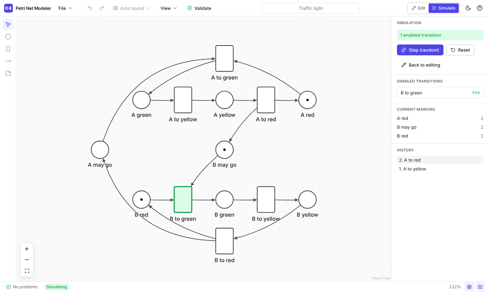
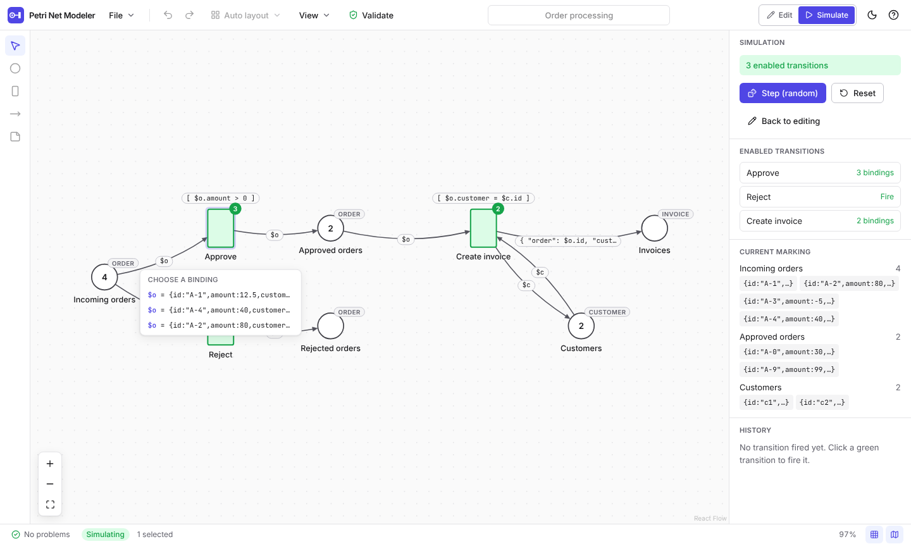
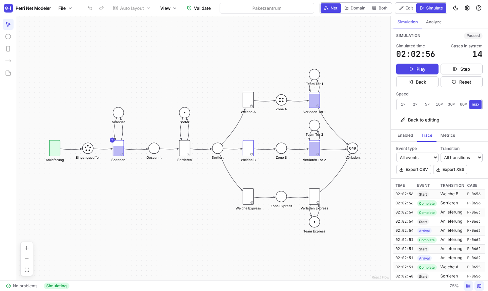
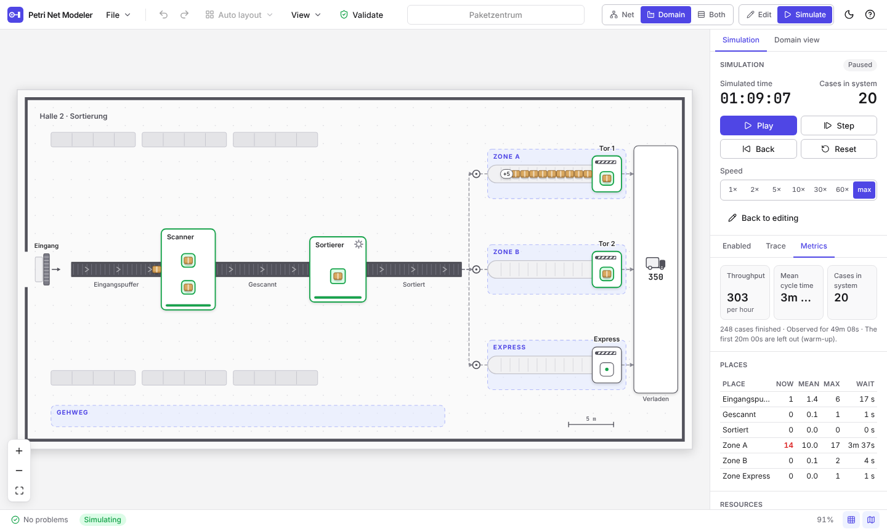
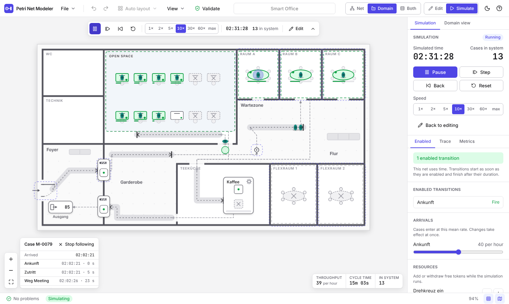

# Petri Net Modeling

A web-based tool for modeling Petri nets. The goal is a fluid, modern diagram editor on top of a formally clean
core: a UI-independent TypeScript package holds the net model, the firing rule and the file format, so the same
logic can later run in a command line tool, behind an API, or inside an LLM processing chain.

<picture>
  <source media="(prefers-color-scheme: dark)" srcset="docs/images/editor-dark.png">
  
</picture>

<picture>
  <source media="(prefers-color-scheme: dark)" srcset="docs/images/json-net-dark.png">
  
</picture>

<picture>
  <source media="(prefers-color-scheme: dark)" srcset="docs/images/simulation-dark.png">
  
</picture>

<picture>
  <source media="(prefers-color-scheme: dark)" srcset="docs/images/domain-hall-dark.png">
  
</picture>

<picture>
  <source media="(prefers-color-scheme: dark)" srcset="docs/images/domain-office-dark.png">
  
</picture>

**Status: 0.9.0 (milestones M0 to M4, the UI polish step, D1 to D4: PNML, PNG and TikZ export and a command line next to the domain view).** The editor handles place/transition nets (P/T nets) and **JSON nets**:
tokens are JSON values, places carry types as JSON Schema, input arcs bind variables, and guards and output
inscriptions are [JSONata](https://jsonata.org/) expressions. See [`PLAN.md`](PLAN.md) for the overall plan and
[`docs/plan/M0-M1_Umsetzungsplan.md`](docs/plan/M0-M1_Umsetzungsplan.md),
[`docs/plan/M2_Umsetzungsplan.md`](docs/plan/M2_Umsetzungsplan.md),
[`docs/plan/UI-Polish_Umsetzungsplan.md`](docs/plan/UI-Polish_Umsetzungsplan.md) and
[`docs/plan/M3_Umsetzungsplan.md`](docs/plan/M3_Umsetzungsplan.md) and
[`docs/plan/D1_Umsetzungsplan.md`](docs/plan/D1_Umsetzungsplan.md) and
[`docs/plan/D2_Umsetzungsplan.md`](docs/plan/D2_Umsetzungsplan.md) and
[`docs/plan/D3_Umsetzungsplan.md`](docs/plan/D3_Umsetzungsplan.md) and
[`docs/plan/D4_Umsetzungsplan.md`](docs/plan/D4_Umsetzungsplan.md) for the plans of the increments (in German).

## Features

- Draw places, transitions and arcs; rename, move, delete; weights, initial tokens and capacities.
- Fast to use: drag from the ring around a node to draw an arc (or `Alt` + drag from anywhere on it), double click to
  rename in place (also the weight or inscription of an arc), right click for a context menu, double click a tool to
  keep it active, `Tab` adds the next node and connects it, so a net can be built from the keyboard alone.
  Tooltips show the shortcuts.
- Rubber-band and multi-selection, align and distribute, grid snapping, pan, zoom, minimap. The wheel pans,
  `Ctrl`/`Cmd` + wheel or pinch zooms, details fade out when zoomed out and a hover card shows everything about a node.
- Undo/redo, copy/paste/duplicate, keyboard shortcuts (press `?` in the app).
- Automatic layout with ELK (left to right or top to bottom), undoable.
- Save and open `.pn.json` files (also by drag and drop), autosave to IndexedDB with restore on start.
- Import and export: **PNML** in both directions (standard `ptnet` plus a `toolspecific` extension for everything
  else; files of ProM, pm4py and WoPeD are read, with remarks), **images** as SVG or PNG (1x to 3x, light or dark,
  transparent), **TikZ** for LaTeX and `.pn.json` (File > Import, File > Export, `Ctrl+Shift+E`). The domain view exports
  as PNG.
- Live validation: bipartiteness, dangling arcs, duplicate names, capacity violations and more, with click-to-select.
- Simulation mode: enabled transitions are highlighted green, click to fire, random step, step back, reset, firing
  history.
- Light and dark theme, Inter and JetBrains Mono bundled with the app, accessible components with visible focus
  rings and ARIA labels, reduced motion respected.
- Bundled examples: producer/consumer, traffic light, dining philosophers, mutual exclusion.

Timed simulation (0.4.0, see [docs/simulation.md](docs/simulation.md)):

- Durations (fixed, uniform, exponential), priorities for conflicts and arrival rates per transition, roles for places
  (source, sink, resource, case) and simulation settings (seed, warm-up, start time, case id prefix), all optional and
  edited in the properties panel.
- A discrete-event engine (`@pnm/sim`) with two-phase firing (tokens are taken at the start, given at the end), parallel
  firings limited by resource places, capacity reservation, cases that stay with their tokens, seeded randomness and an
  event stream. It runs in a Web Worker, so the page stays responsive even at maximum speed.
- Play and pause, step, step back (500 steps), reset, speeds from 1x to 60x and max, breakpoints on transitions and
  places, progress bars on running transitions, tokens that move along the arcs, queue rings on the canvas.
- A trace of events with filters, key figures (throughput, cycle time, queues, utilisation of resources), sliders for
  arrival rates and buttons to add or withdraw resources while the simulation runs.
- Export of the event log as CSV (`case_id, activity, timestamp, lifecycle`) or XES for process mining tools.
- Examples: parcel center, smart office, complaint handling (from the domain view mockup).

Domain view (0.5.0, see [docs/domain-view.md](docs/domain-view.md)):

- A second view next to the net editor (switch _Net | Domain | Both_ in the header, keys `1`, `2`, `3`) that draws the
  net as what it models: a hall with conveyor belts, stations, gates and a loading area, a floor plan with rooms, desks,
  meeting tables, turnstiles and doors, or a generic process picture. It is drawn on a Canvas 2D with sprites for
  parcels, people, vehicles and documents, in the light and the dark theme, sharp on high-density screens.
- The picture is a declarative **mapping** stored with the net (`domainView`) that says where and as what each place and
  transition is drawn. It has no behaviour: durations, weights and rates stay in the net. Eight rules (V1 to V8) check
  it against the net, so a wrong or outdated mapping is reported instead of believed; every entry records whether it
  is generic, from you or from a language model.
- Every net gets a generic view at one click (_Generate generic view_), derived from the editor positions and the roles
  of the places. The parcel center (hall) and the smart office (floor plan) come with hand-made mappings.
- Hovering an element lights up its counterpart in the other view, a click selects it, and while simulating the view
  shows the current marking and the firings under way. Pan, zoom (wheel, pinch, buttons) and fit work as in the editor.
- The _Domain view_ tab shows the problems with click-to-select, repairs a view after the net has changed (_Fill
  missing entries_, _Update hash_) and edits the mapping as JSON with live checks.
- Not yet: editing by dragging in the picture (step D4).

Animation (0.6.0, see the section _Animation_ in [docs/domain-view.md](docs/domain-view.md)):

- The domain view runs the simulation: every event of the stream becomes a movement or a visible change. Cases move
  along belts and connectors, stations show whether they are free, busy or blocked, slots show a progress ring, queues
  turn yellow and red when they grow (with the limits of the key figure settings), counters count up when a case
  arrives. The simulator never waits for the picture; speed _max_ and `prefers-reduced-motion` make cases jump.
- A bar in the view starts and controls the simulation (play, step, back, reset, speed, clock) and a strip shows
  throughput, cycle time and cases in the system. Hover cards tell how a station or queue is doing.
- A click on a case follows it (a ring, a card with its steps and times); a click on an enabled station fires its
  transition.
- The picture is rendered in two layers (the static one offscreen) and the loop rests when nothing moves; 200 cases
  take about a millisecond per frame. A test compares a log of what the picture did with the event stream, and the
  same seed still gives the same events and the same exports with the view running.

Editing the layout (0.8.0, see the section _Editing the view_ in [docs/domain-view.md](docs/domain-view.md)):

<picture>
  <source media="(prefers-color-scheme: dark)" srcset="docs/images/domain-edit-dark.png">
  
</picture>

- The switch _Inspect | Edit layout_ (key `E`) turns the picture into an editor: drag stations, rooms, gates, pools, sinks
  and decor, resize boxes by their handles, pull the points of belts, queues and arcs (click the middle of a segment to
  add a point, double click a point to remove it), move slots inside a station and change the kind of an entry. The picture
  follows the pointer, a drag is one undo step, the grid is the one of the editor (Alt: off, Shift on a corner: keep the
  proportions), the arrow keys nudge by 1 px (Shift: 8 px).
- `Delete` hides an entry in the view and keeps the element in the net; only decor is removed. Hidden entries stay visible
  as dashed placeholders. A right click opens a menu (kind, points, slots, hide and show, reset to generic, edit JSON,
  add room, zone, wall, label, furniture or scale bar). Every hand change sets the origin of the entry to `user`.
- The domain panel edits the same entry as numbers and lists, and a card _The view is out of date_ fills only the missing
  entries, removes the stale ones or updates the hash, each as its own undo step. The JSON editor stays as the second way.
- Event logs were checked with pm4py (acceptance A8): `pnpm --filter @pnm/io check:pm4py`, result in
  [docs/eval/pm4py-2026-10-28.md](docs/eval/pm4py-2026-10-28.md).

LLM generation (0.7.0, see the section _Generating a view with an LLM_ in [docs/domain-view.md](docs/domain-view.md)):

<picture>
  <source media="(prefers-color-scheme: dark)" srcset="docs/images/llm-generate-dark.png">
  
</picture>

- _Generate with LLM…_ asks a language model for the mapping from the net and a sentence about the domain. The model only
  proposes: the rules V1 to V8 check the answer, the findings go back as a repair request (at most three rounds in all),
  and what stays invalid is dropped and filled in generically. Every entry keeps its origin (`llm` with the model, or
  `generic`), and the net alone still decides the behaviour. No model is involved while a simulation runs.
- Any OpenAI-compatible server works: Ollama or LM Studio on your machine, or a cloud service. Base URL, model, API key,
  temperature and JSON mode are set in the browser (_LLM provider…_), with a connection test and a list of models. The
  key stays in this browser, apart from the other settings, and is never saved in a net, an export or a log. The
  structure of the net is sent to the provider you choose, so use a local model for nets that must not leave the machine.
- The dialog shows the progress per round, then a preview, the origin summary, the findings, the log of the rounds and the
  prompt. _Use this view_ is one undo step. The panel tells which model generated the view and opens the log, which is
  stored with the net (`domainViewGeneration`).
- `pnpm --filter @pnm/llm eval -- --base-url <url> --model <name>` measures a model on the parcel center and the smart
  office and writes a report to [docs/eval](docs/eval/README.md).

JSON nets (switch the net class in the properties panel):

- Type management: types are JSON Schemas, edited in a dialog with syntax highlighting, error marks, templates and a
  "test a value" area.
- Arc inscriptions and guards in code editors with JSONata highlighting, live syntax checks, variable completion
  (`Ctrl+Space`) and warnings for unbound variables; shown on the canvas (View > Show inscriptions).
- Token lists per place with a type aware editor; tokens that violate the place type are flagged.
- Simulation with computed bindings: a transition with several bindings opens a list to choose from (arrow keys and
  Enter work), the history records the binding of every step, evaluation problems are reported in the status bar.
- JSON net examples: order processing, token ring, dining philosophers with typed tokens.
- A place/transition net is the special case without types, guards and inscriptions; switching the class loses no data.

## Quick start

Requirements: Node.js 22 and pnpm 10 (`corepack enable` activates the pinned pnpm version).

```sh
pnpm install
pnpm dev          # starts the editor at http://localhost:5173
```

## Command line

`pnm` validates, simulates, exports, imports and lays out nets and checks or generates domain views without a browser;
it is one bundled file for Node 22 (`pnpm --filter @pnm/cli build`, part of `pnpm build`).

```sh
node apps/cli/dist/pnm.js validate examples/parcel-center.pn.json
node apps/cli/dist/pnm.js simulate examples/parcel-center.pn.json --seconds 7200 --csv events.csv
node apps/cli/dist/pnm.js export examples/producer-consumer.pn.json --format tikz -o net.tex
node apps/cli/dist/pnm.js import net.pnml -o net.pn.json
```

See [docs/cli.md](docs/cli.md).

## Scripts

Run from the repository root.

| Script           | Purpose                                                                                                          |
| ---------------- | ---------------------------------------------------------------------------------------------------------------- |
| `pnpm dev`       | Start the Vite dev server for the web app.                                                                       |
| `pnpm build`     | Typecheck all packages, build the web app into `apps/web/dist` and the command line into `apps/cli/dist/pnm.js`. |
| `pnpm test`      | Run all unit and component tests (Vitest).                                                                       |
| `pnpm test:e2e`  | Run the Playwright tests against the dev server.                                                                 |
| `pnpm lint`      | ESLint with zero warnings allowed.                                                                               |
| `pnpm typecheck` | `tsc --noEmit` in every package.                                                                                 |
| `pnpm format`    | Format everything with Prettier (`format:check` only verifies).                                                  |

### End-to-end tests

The Playwright tests start the dev server themselves. In CI the browser comes from
`pnpm --filter @pnm/web exec playwright install --with-deps chromium`. On a machine that already has a Chromium
build, point the tests to it instead of downloading one:

```sh
PNM_CHROMIUM_PATH=/path/to/chromium pnpm test:e2e
```

`PNM_E2E_PORT=5191` moves the dev server to another port if 5173 is taken.

## Repository layout

```
apps/web          @pnm/web     React 19 + Vite + Tailwind 4 editor (React Flow canvas)
apps/cli          @pnm/cli     Command line `pnm`, bundled with esbuild into one file
packages/expr     @pnm/expr    Expression language adapter (JSONata): guards, output inscriptions, input inscriptions
packages/core     @pnm/core    Net model, operations, validation, firing rules, bindings, types, file format
packages/layout   @pnm/layout  ELK-based automatic layout and the drawing geometry
packages/sim      @pnm/sim     Timed discrete-event simulation: engine, key figures, Web Worker protocol
packages/io       @pnm/io      Event log as CSV and XES, PNML in both directions, SVG and TikZ export, XML reader
packages/domain   @pnm/domain  Domain view: mapping schema, rules V1 to V8, generic mapping, scene builder, Canvas 2D painter
packages/llm      @pnm/llm     LLM generation of the mapping: OpenAI-compatible provider, prompts, repair loop, evaluation script
examples/         Example nets (*.pn.json), also used as regression tests and shown in the app
docs/             Architecture decisions (adr/), file format (format.md), plans (plan/)
.github/          CI and GitHub Pages deployment
```

`@pnm/core`, `@pnm/expr`, `@pnm/sim` and `@pnm/io` have no React dependency, and the engine runs in Node as well as in a
worker. The web app talks to the core only through immutable
operations such as `addPlace`, `addArc` or `setInscription`, which return new nets, and through `findEnabled` and
`fireBinding` for the firing rule.

## Documentation

- [File format](docs/format.md): the `.pn.json` structure, types, inscriptions, evaluation rules, validation codes and
  the P/T firing rule.
- [Expressions](docs/expressions.md): a short guide to guards and inscriptions for modelers.
- [Simulation](docs/simulation.md): durations, resources, arrivals, cases, key figures, the event log and its export,
  controls and limits.
- [PNML](docs/format.md#pnml), [TikZ export](docs/tikz.md) and [command line](docs/cli.md).
- [Domain view](docs/domain-view.md): the mapping, its rules, drawing, animation and the generation by a language model.
- [Architecture decision records](docs/adr): monorepo and TypeScript, React Flow canvas, JSON net profile, document
  history, JSONata expressions, Radix primitives and self-hosted fonts, discrete-event simulation, the domain view
  mapping, its animation, the generation of the mapping by a language model, its editing, and interchange and the
  command line.
- [Review screenshots](docs/images/review): all seven examples in the detail, mid and far zoom levels, light and dark,
  at 1280 px and 1920 px width (`<example>_<theme>_<width>_<level>.png`).
- [Changelog](CHANGELOG.md)

## Deployment

Pushes to `main` build the app with `VITE_BASE=/Petri-Net-Modeling/` and publish it to GitHub Pages
(`.github/workflows/deploy.yml`). Locally the base path defaults to `/`.

## License

[MIT](LICENSE)
