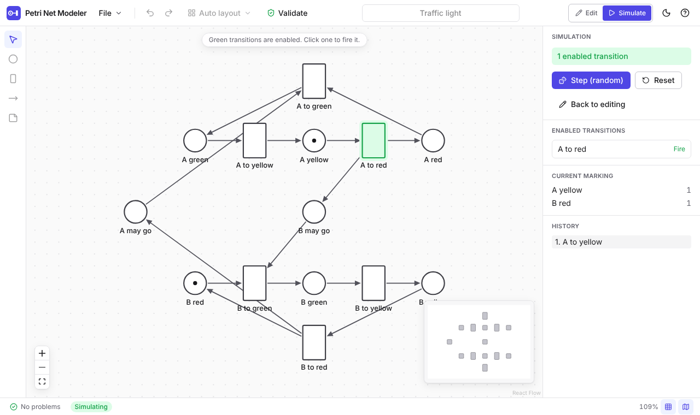
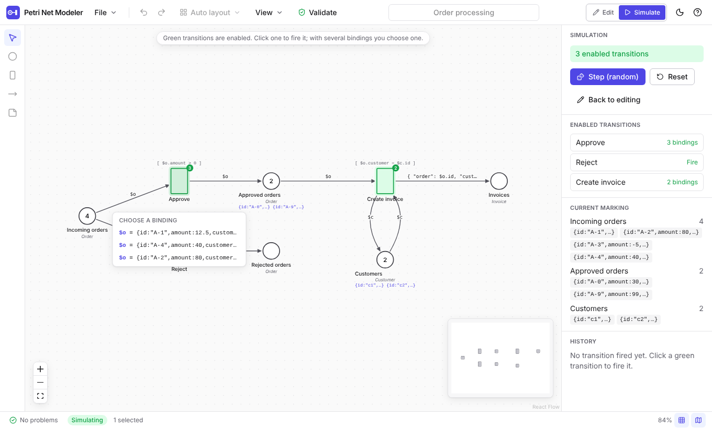

# Petri Net Modeling

A web-based tool for modeling Petri nets. The goal is a fluid, modern diagram editor on top of a formally clean
core: a UI-independent TypeScript package holds the net model, the firing rule and the file format, so the same
logic can later run in a command line tool, behind an API, or inside an LLM processing chain.





**Status: 0.2.0 (milestones M0 to M2).** The editor handles place/transition nets (P/T nets) and **JSON nets**:
tokens are JSON values, places carry types as JSON Schema, input arcs bind variables, and guards and output
inscriptions are [JSONata](https://jsonata.org/) expressions. See [`PLAN.md`](PLAN.md) for the overall plan and
[`docs/plan/M0-M1_Umsetzungsplan.md`](docs/plan/M0-M1_Umsetzungsplan.md) and
[`docs/plan/M2_Umsetzungsplan.md`](docs/plan/M2_Umsetzungsplan.md) for the plans of the increments (in German).

## Features

- Draw places, transitions and arcs; rename, move, delete; weights, initial tokens and capacities.
- Rubber-band and multi-selection, align and distribute, grid snapping, pan, zoom, minimap.
- Undo/redo, copy/paste/duplicate, keyboard shortcuts (press `?` in the app).
- Automatic layout with ELK (left to right or top to bottom), undoable.
- Save and open `.pn.json` files (also by drag and drop), export SVG, autosave to IndexedDB with restore on start.
- Live validation: bipartiteness, dangling arcs, duplicate names, capacity violations and more, with click-to-select.
- Simulation mode: enabled transitions are highlighted green, click to fire, random step, reset, firing history.
- Light and dark theme, accessible components with visible focus rings and ARIA labels.
- Bundled examples: producer/consumer, traffic light, dining philosophers, mutual exclusion.

JSON nets (switch the net class in the properties panel):

- Type management: types are JSON Schemas, edited in a dialog with syntax highlighting, error marks, templates and a
  "test a value" area.
- Arc inscriptions and guards in code editors with JSONata highlighting, live syntax checks, variable completion
  (`Ctrl+Space`) and warnings for unbound variables; shown on the canvas (View > Show inscriptions).
- Token lists per place with a type aware editor; tokens that violate the place type are flagged.
- Simulation with computed bindings: a transition with several bindings opens a list to choose from (arrow keys and
  Enter work), the history records the binding of every step, evaluation problems are reported in the status bar.
- JSON net examples: order processing, token ring, dining philosophers with typed tokens.
- A place/transition net is the special case without types, guards and inscriptions; switching the class loses no data.

## Quick start

Requirements: Node.js 22 and pnpm 10 (`corepack enable` activates the pinned pnpm version).

```sh
pnpm install
pnpm dev          # starts the editor at http://localhost:5173
```

## Scripts

Run from the repository root.

| Script           | Purpose                                                            |
| ---------------- | ------------------------------------------------------------------ |
| `pnpm dev`       | Start the Vite dev server for the web app.                         |
| `pnpm build`     | Typecheck all packages and build the web app into `apps/web/dist`. |
| `pnpm test`      | Run all unit and component tests (Vitest).                         |
| `pnpm test:e2e`  | Run the Playwright tests against the dev server.                   |
| `pnpm lint`      | ESLint with zero warnings allowed.                                 |
| `pnpm typecheck` | `tsc --noEmit` in every package.                                   |
| `pnpm format`    | Format everything with Prettier (`format:check` only verifies).    |

### End-to-end tests

The Playwright tests start the dev server themselves. In CI the browser comes from
`pnpm --filter @pnm/web exec playwright install --with-deps chromium`. On a machine that already has a Chromium
build, point the tests to it instead of downloading one:

```sh
PNM_CHROMIUM_PATH=/path/to/chromium pnpm test:e2e
```

## Repository layout

```
apps/web          @pnm/web     React 19 + Vite + Tailwind 4 editor (React Flow canvas)
packages/expr     @pnm/expr    Expression language adapter (JSONata): guards, output inscriptions, input inscriptions
packages/core     @pnm/core    Net model, operations, validation, firing rules, bindings, types, file format
packages/layout   @pnm/layout  ELK-based automatic layout
examples/         Example nets (*.pn.json), also used as regression tests and shown in the app
docs/             Architecture decisions (adr/), file format (format.md), plans (plan/)
.github/          CI and GitHub Pages deployment
```

`@pnm/core` and `@pnm/expr` have no browser or React dependency. The web app talks to the core only through immutable
operations such as `addPlace`, `addArc` or `setInscription`, which return new nets, and through `findEnabled` and
`fireBinding` for the firing rule.

## Documentation

- [File format](docs/format.md): the `.pn.json` structure, types, inscriptions, evaluation rules, validation codes and
  the P/T firing rule.
- [Expressions](docs/expressions.md): a short guide to guards and inscriptions for modelers.
- [Architecture decision records](docs/adr): monorepo and TypeScript, React Flow canvas, JSON net profile, document
  history, JSONata expressions.
- [Changelog](CHANGELOG.md)

## Deployment

Pushes to `main` build the app with `VITE_BASE=/Petri-Net-Modeling/` and publish it to GitHub Pages
(`.github/workflows/deploy.yml`). Locally the base path defaults to `/`.

## License

[MIT](LICENSE)
