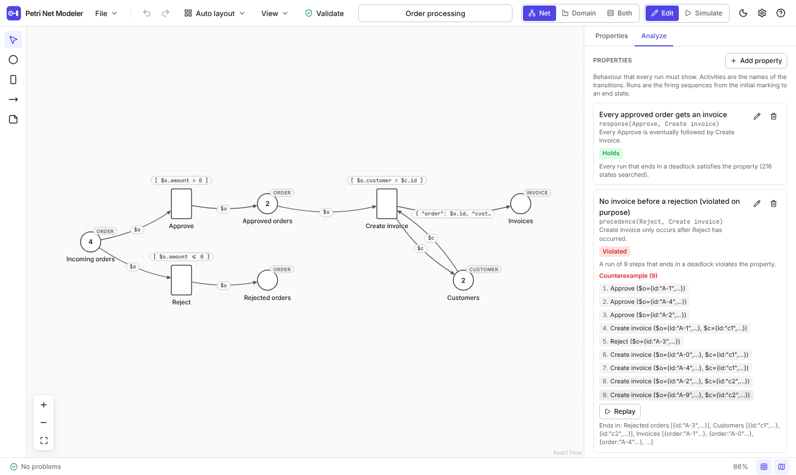

# Petri Net Modeling

A web-based tool for modeling, simulating and analyzing Petri nets, from place/transition nets to **JSON nets** whose
tokens are JSON values. A fluid diagram editor sits on a formally clean, UI-independent TypeScript core, so the same
logic also runs in a command line tool and in an LLM processing chain.

<picture>
  <source media="(prefers-color-scheme: dark)" srcset="docs/images/editor-dark.png">
  
</picture>

**Version 1.2.0.** Try it in the browser: [frybinski.github.io/Petri-Net-Modeling](https://frybinski.github.io/Petri-Net-Modeling/).
The command line comes as one file with each [release](https://github.com/frybinski/Petri-Net-Modeling/releases); a small
[server](#running-on-a-server) shares the tool with a group.

## What it does

| Area             | What you get                                                                                                                                                                                                                                                                                                                                                                                                                                                                                                                                                |
| ---------------- | ----------------------------------------------------------------------------------------------------------------------------------------------------------------------------------------------------------------------------------------------------------------------------------------------------------------------------------------------------------------------------------------------------------------------------------------------------------------------------------------------------------------------------------------------------------- |
| **Editor**       | Draw places, transitions and arcs with weights, tokens and capacities. Drag from a node's ring to draw an arc, double click to rename, `Tab` adds the next node and connects it. Rubber-band selection, align and distribute, grid, minimap, undo and redo, copy and paste (also between nets, with the types), automatic layout (ELK), live validation, keyboard shortcuts (`?`), light and dark theme, bundled examples. Files are `.pn.json` (also by drag and drop) with autosave.                                                                      |
| **Net classes**  | Place/transition nets and JSON nets: types as JSON Schema, input arcs that bind variables, guards and output inscriptions in [JSONata](https://jsonata.org/), with code editors, completion, a type manager and computed bindings. A P/T net is the special case without them. See [docs/format.md](docs/format.md) and [docs/expressions.md](docs/expressions.md).                                                                                                                                                                                         |
| **Simulation**   | A seeded discrete-event engine in a Web Worker: durations, priorities, arrival rates, resources, cases, two-phase firing, speeds from 1x to max, step back, breakpoints, a trace, key figures (throughput, cycle time, queues, utilisation) and the event log as CSV and XES. See [docs/simulation.md](docs/simulation.md).                                                                                                                                                                                                                                 |
| **Replay**       | Event logs (CSV, XES, from this tool or others) replayed on the net as a simulation: cases enter with their first event, activities take and put tokens at the times of the log, and where the log does not fit the net a token is created and the deviation is counted, with the token-replay fitness. The net view, the domain view, the trace and the key figures show it like a run; a live feed takes events as they arrive. See [docs/replay.md](docs/replay.md).                                                                                     |
| **Domain view**  | The net drawn as what it models: a hall with belts and stations, a floor plan, or a generic process picture, from a declarative mapping that is checked by eight rules. It is animated from the event stream, editable by dragging, and can be generated by a language model through any OpenAI-compatible server. See [docs/domain-view.md](docs/domain-view.md).                                                                                                                                                                                          |
| **LLM**          | _Generate with LLM_ asks a model for the mapping from the net and a sentence about the domain. The model only proposes; the rules decide, findings go back as a repair request, and every entry records its origin. The key stays in your browser, or on the server if there is one.                                                                                                                                                                                                                                                                        |
| **Interchange**  | **PNML** in both directions (files of ProM, pm4py and WoPeD are read, with remarks), **SVG** and **PNG** (1x to 3x, light, dark or transparent), **TikZ** for LaTeX, and the domain view as PNG. See [docs/tikz.md](docs/tikz.md).                                                                                                                                                                                                                                                                                                                          |
| **Analysis**     | Structure (state machine, marked graph, free choice, siphons, traps), place and transition invariants, the state space with boundedness, deadlocks and liveness, coverability for P/T nets, and **DECLARE/LTLf** properties checked on the state space with shortest counterexamples, or on simulation logs. See [docs/analysis.md](docs/analysis.md).                                                                                                                                                                                                      |
| **Command line** | `pnm` validates, simulates, replays event logs, analyzes, checks, exports, imports and lays out nets and works with domain views, as one file for Node 22. See [docs/cli.md](docs/cli.md).                                                                                                                                                                                                                                                                                                                                                                  |
| **Server**       | A small Node program (`apps/server`, one container) that serves the app inside a network, passes language model requests to Ollama or Open WebUI with a key that only the server knows, offers the functions of the command line over HTTP with hard time and memory limits, and stores projects with versions, share links and a trash. The app finds it by itself and adds _Open from server_, _Save to server_, _Versions_ and _Share_; without a server nothing changes. See [docs/server.md](docs/server.md) and [deploy/README.md](deploy/README.md). |

## Screenshots

<picture>
  <source media="(prefers-color-scheme: dark)" srcset="docs/images/json-net-dark.png">
  
</picture>

<picture>
  <source media="(prefers-color-scheme: dark)" srcset="docs/images/simulation-dark.png">
  
</picture>

<picture>
  <source media="(prefers-color-scheme: dark)" srcset="docs/images/domain-hall-dark.png">
  
</picture>

<picture>
  <source media="(prefers-color-scheme: dark)" srcset="docs/images/domain-office-dark.png">
  
</picture>

<picture>
  <source media="(prefers-color-scheme: dark)" srcset="docs/images/domain-edit-dark.png">
  
</picture>

<picture>
  <source media="(prefers-color-scheme: dark)" srcset="docs/images/llm-generate-dark.png">
  
</picture>

<picture>
  <source media="(prefers-color-scheme: dark)" srcset="docs/images/analysis-dark.png">
  
</picture>

All ten examples at three zoom levels and two window widths are in [docs/images/review](docs/images/review)
(`<example>_<theme>_<width>_<level>.png`).

## Quick start

Requirements: Node.js 22 and pnpm 10 (`corepack enable` activates the pinned pnpm version).

```sh
pnpm install
pnpm dev          # starts the editor at http://localhost:5173
```

Then open an example from _File_ and press _Simulate_, or switch to _Domain_ with the key `2`. The command line:

```sh
node apps/cli/dist/pnm.js validate examples/parcel-center.pn.json        # after pnpm build
node apps/cli/dist/pnm.js simulate examples/parcel-center.pn.json --seconds 7200 --csv events.csv
node apps/cli/dist/pnm.js replay examples/parcel-center.pn.json events.csv --time-origin net   # fitness 1.0
node apps/cli/dist/pnm.js analyze examples/dining-philosophers-3.pn.json
node apps/cli/dist/pnm.js check examples/order-processing.pn.json --declare "response(Approve, Create invoice)"
node apps/cli/dist/pnm.js export examples/producer-consumer.pn.json --format tikz -o net.tex
```

### Scripts

Run from the repository root.

| Script              | Purpose                                                                                                                                                        |
| ------------------- | -------------------------------------------------------------------------------------------------------------------------------------------------------------- |
| `pnpm dev`          | Start the Vite dev server for the web app.                                                                                                                     |
| `pnpm build`        | Typecheck all packages, build the web app into `apps/web/dist`, the command line into `apps/cli/dist/pnm.js` and the server into `apps/server/dist/server.js`. |
| `pnpm test`         | Run all unit and component tests (Vitest).                                                                                                                     |
| `pnpm test:scripts` | Test the release scripts in `scripts/`.                                                                                                                        |
| `pnpm test:e2e`     | Run the Playwright tests: against the dev server, and against the real server process (it builds the app and the server first).                                |
| `pnpm lint`         | ESLint with zero warnings allowed.                                                                                                                             |
| `pnpm typecheck`    | `tsc --noEmit` in every package.                                                                                                                               |
| `pnpm format`       | Format everything with Prettier (`format:check` only verifies).                                                                                                |

The Playwright tests start the dev server themselves. In CI the browser comes from
`pnpm --filter @pnm/web exec playwright install --with-deps chromium`. On a machine that already has a Chromium build,
point the tests to it with `PNM_CHROMIUM_PATH=/path/to/chromium pnpm test:e2e`; `PNM_E2E_PORT=5191` moves the dev
server to another port if 5173 is taken. `scripts/screenshots.mjs` makes the pictures above from a running app.

The tests of the server mode (`apps/web/e2e/server`) run against the real server process, which the Playwright
configuration builds and starts together with a stand-in for the language model server (its port is
`PNM_E2E_SERVER_PORT`, 1000 above the dev server by default). `PNM_E2E_SKIP_BUILD=1` skips the build if the app and the
server are built already; `PNM_E2E_NO_SERVER=1` leaves these tests out.

### Repository layout

```
apps/web          @pnm/web     React 19 + Vite + Tailwind 4 editor (React Flow canvas)
apps/cli          @pnm/cli     Command line `pnm`, bundled with esbuild into one file; its logic is the library `src/lib` that the server uses too
apps/server       @pnm/server  Server: web app, LLM proxy, HTTP interface for the tools, project store; bundled to `dist/server.js`
packages/expr     @pnm/expr    Expression language adapter (JSONata): guards, output inscriptions, input inscriptions
packages/core     @pnm/core    Net model, operations, validation, firing rules, bindings, types, file format
packages/layout   @pnm/layout  ELK-based automatic layout and the drawing geometry
packages/sim      @pnm/sim     Timed discrete-event simulation: engine, replay of event logs, key figures, Web Worker protocol
packages/io       @pnm/io      Event log as CSV and XES (write and read), PNML in both directions, SVG and TikZ export, XML reader
packages/analysis @pnm/analysis Structure, invariants, state space, coverability, DECLARE and LTLf checking, conformance, worker
packages/domain   @pnm/domain  Domain view: mapping schema, rules V1 to V8, generic mapping, scene builder, Canvas 2D painter
packages/llm      @pnm/llm     LLM generation of the mapping: OpenAI-compatible provider, prompts, repair loop, evaluation script
examples/         Example nets (*.pn.json), also used as regression tests and shown in the app
deploy/           Dockerfile, Docker Compose files, `.env.example`, smoke test and the guide for running the server
docs/             Documentation, architecture decisions (adr/), plans (plan/)
scripts/          Release notes and assets, screenshots, the demo feed for the live source
.github/          CI, release, GitHub Pages deployment and the image for the registry
.gitlab-ci.yml    Pipeline of the mirror in KIT GitLab: checks and the container image
```

`@pnm/core`, `@pnm/expr`, `@pnm/sim`, `@pnm/io` and `@pnm/analysis` have no React dependency, and the engine runs in Node
as well as in a worker. The web app talks to the core only through immutable operations such as `addPlace`, `addArc` or
`setInscription`, which return new nets, and through `findEnabled` and `fireBinding` for the firing rule. The parts that
most sessions never open (analysis, domain view, export formats, LLM dialogs) load on demand: the page fetches 351 kB of
JavaScript (gzipped) at start.

## Running on a server

The tool runs as one container next to Ollama or Open WebUI for a group, for example inside the network of a university
or an institute. The server is a small Node program (`apps/server`, bundled to `dist/server.js`, no database and no
runtime dependency) that

- serves the web app, which then finds it by itself and adds _File > Open from server_, _Save to server_ (`Ctrl+S`),
  _Versions_ and _Share_ (links to look or to edit, `/s/<token>`);
- passes language model requests to an Ollama or Open WebUI server and adds the key, so the users need none
  (`POST /llm/v1/chat/completions`, `GET /llm/v1/models`, nothing else);
- offers the functions of the command line over HTTP (`/api/v1/validate`, `simulate`, `replay`, `analyze`, `check`,
  `convert`, `layout`, `domain/...`), computed by the same code, in threads with a time and memory limit;
- stores projects as files with immutable versions, `If-Match` against overwriting, share links and a trash.

```sh
# Try it on your machine; a stand-in answers for the language model, no GPU is needed.
docker compose -f deploy/compose.local.yaml up --build         # http://localhost:8080

# Or from the sources:
pnpm install && pnpm build
PNM_PUBLIC_URL=http://localhost:8080 PNM_DATA_DIR=/tmp/pnm-data PNM_PORT=8080 \
  PNM_ALLOWED_NETS=0.0.0.0/0,::/0 node apps/server/dist/server.js

# Use the interface:
curl -s -X POST -H 'Content-Type: application/json' --data @examples/producer-consumer.pn.json \
  http://localhost:8080/api/v1/analyze
```

In production the image comes from a container registry (built by GitLab CI from a mirror of this repository, or pushed
by GitHub Actions), Docker Compose pulls it, and the existing ingress of the host (Traefik or nginx) makes it
available with TLS; the server is meant for a closed network and checks the client address, the `Host` header and the
`Origin` itself. [deploy/README.md](deploy/README.md) is the guide for the people who set it up (registry login, `.env`,
ingress entries, update and rollback, backup, the service account in Open WebUI, troubleshooting).
[docs/server.md](docs/server.md) describes the interface, the settings and the security.

## Documentation

All documents are indexed in [docs/README.md](docs/README.md).

- [File format](docs/format.md): the `.pn.json` structure, types, inscriptions, evaluation rules, validation codes, the
  P/T firing rule and PNML.
- [Expressions](docs/expressions.md): a short guide to guards and inscriptions for modelers.
- [Simulation](docs/simulation.md): durations, resources, arrivals, cases, key figures, the event log and its export,
  controls and limits.
- [Replay of event logs](docs/replay.md): log formats, the mapping of activities, the rules of the replay, fitness and
  deviations, the live feed and `window.pnm.live`.
- [Domain view](docs/domain-view.md): the mapping, its rules, drawing, animation, editing and the generation by a language
  model.
- [Analysis and verification](docs/analysis.md): structure, invariants, state space, coverability, DECLARE templates,
  LTLf, counterexamples, event logs and the limits.
- [TikZ export](docs/tikz.md) and [command line](docs/cli.md) (with the install from a release).
- [Server](docs/server.md): the web app, the language model proxy, the HTTP interface and the project store of
  `apps/server`; [deploy/README.md](deploy/README.md) sets it up with Docker Compose.
- [Known limitations](docs/limitations.md), [architecture decision records](docs/adr) and the
  [plans of the increments](docs/plan) (in German), [PLAN.md](PLAN.md) for the overall plan.
- [Changelog](CHANGELOG.md).

## Known limitations

What 1.2.0 does not do, in short; the reasons and the way forward are in [docs/limitations.md](docs/limitations.md).

- **Tab with a selected node** adds the next node and connects it instead of moving the focus. `Esc` deselects and gives
  `Tab` back; the shortcut help (`?`) says so.
- **A tooltip may stay for a moment** when an automated pointer jumps between controls, and **names are tight** between
  40 % and 70 % zoom when nodes are close together.
- **JSONata time limit.** The 1 s limit for a guard or inscription does not interrupt a single long native operation such
  as a pathological regular expression in `$match`. On the [server](#running-on-a-server) the computations run in threads
  that are ended after `PNM_JOB_TIMEOUT`, so this is fixed there.
- **AND joins in P/T nets** match tokens by order; cases that overtake each other can be merged. Use a JSON net with a case
  field and the same variable on both input arcs.
- **The event log keeps the latest 200 000 events** (a toast says when older ones are dropped; the key figures are not
  affected). **Back and Reset** in the domain view jump instead of playing backwards.
- **Domain view.** A resource place with cells edits its station; keyboard access to the picture is partial (`Tab`
  through the entries in Edit layout, `Enter` for the label, drawing needs a pointer).
- **The LLM provider.** A page on HTTPS may not reach an `http://localhost` provider (run the app locally or use an
  `https://` address), and the API key lives in the browser's `localStorage`. Both are fixed when the app is served by a
  [server](#running-on-a-server): the preset _Server (Ollama)_ talks to the server's own address and needs no key.
- **Server.** No accounts: everyone who reaches the server sees every project. No real-time co-editing; a save that
  is based on an old version is refused and the person chooses to reload or to save a copy. See
  [docs/limitations.md](docs/limitations.md#server).
- **Replay.** A replay describes what the log says and does not check the net's data: guards only on request, output
  inscriptions never, capacities and types not at all. Time is not interpolated (an end without a start takes no time or
  lasts since the previous event), start and end are paired first in, first out, fitness counts a case as finished at a
  sink place, and the live source has no connection to the outside apart from the paste field and
  `window.pnm.live` in the console.
- **Interchange.** The command line is one 5 MB file; PNML pages are laid side by side from the positions of their nodes;
  structure and invariants of JSON nets are computed on the skeleton of the net.

## Deployment

The container image of the server is built from `deploy/Dockerfile`: on every push and pull request by `ci.yml` (without
pushing, followed by a smoke test), on a tag by the pipeline of the mirror in KIT GitLab (`.gitlab-ci.yml`) or, if
`KIT_REGISTRY_IMAGE` is set, by `.github/workflows/image.yml`.

Pushes to `main` build the app with `VITE_BASE=/Petri-Net-Modeling/` and publish it to GitHub Pages
(`.github/workflows/deploy.yml`). A tag `v<version>` runs `.github/workflows/release.yml`: it tests and builds, then
publishes a GitHub release with `pnm-<version>.js`, its SHA-256 sum and the notes from the [changelog](CHANGELOG.md). Run
by hand with `dry_run` it does everything except creating the release. Locally the base path defaults to `/`.

## License

[MIT](LICENSE)
