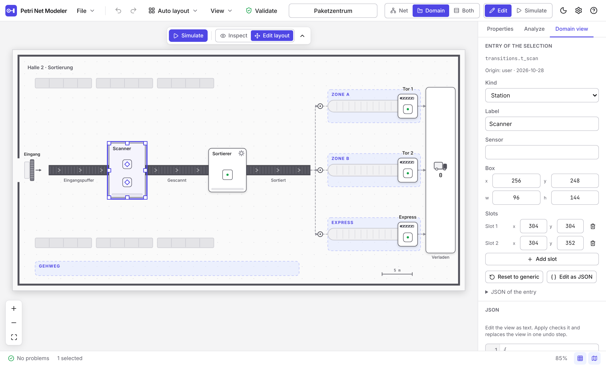
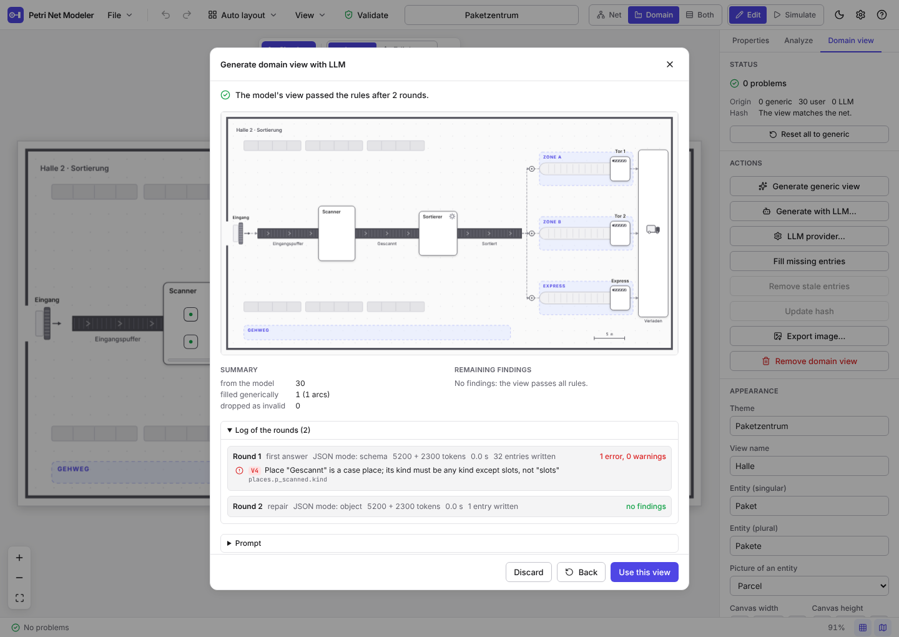
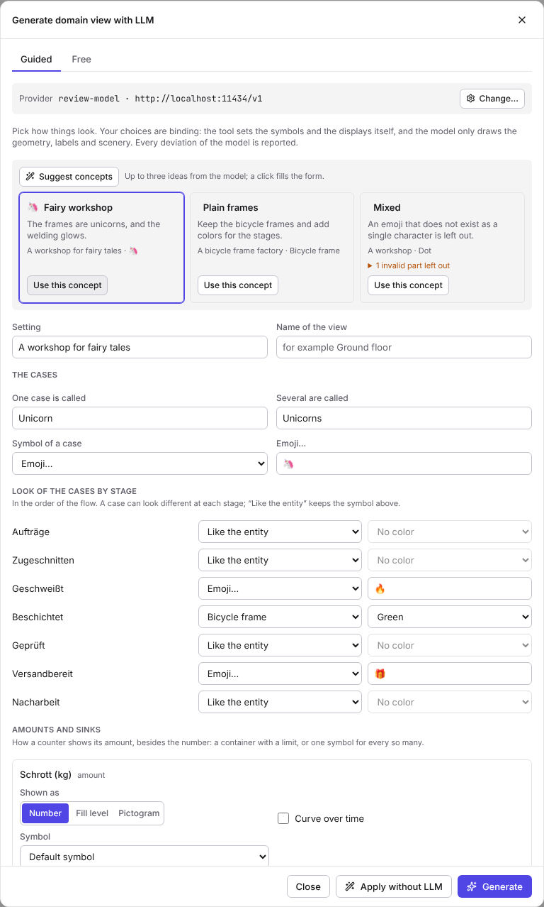
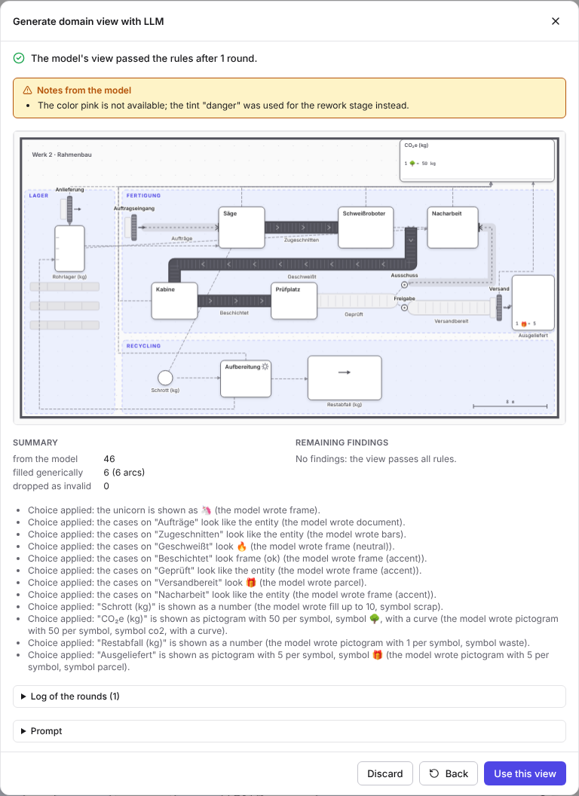

# Domain view

A domain view draws a Petri net in the terms of its domain: a hall with conveyor belts, stations and loading gates, a
floor plan with rooms, desks and doors, or, when nothing better is known, a generic picture of belts and stations. It
is a second view next to the net editor, drawn on a Canvas 2D from the net, a **mapping** and a marking.

The principle, which every part of the design follows: **the view shows, the net decides.** A mapping says _where_ and
_as what_ an element is drawn. It contains no durations, weights, rates or conditions (the net has them), and nothing
in it changes how the net behaves. The mapping is data that a person, a tool or a language model can write; it is
checked against the net instead of trusted (rules V1 to V12 below).

The code lives in `packages/domain` (`@pnm/domain`). It depends on `@pnm/core` and `@pnm/layout` and has no React
dependency; the core does not depend on it.

## Where the mapping is stored

In the net document under `domainView` (see [format.md](format.md)). The format version stays `1.0`; files without the
field are valid as before. The core stores the value as it is (`unknown`) and `@pnm/domain` validates it:

```ts
import { validateDomainView } from '@pnm/domain';

const { ok, view, diagnostics } = validateDomainView(net, net.domainView);
```

Editing the net does not touch the mapping. A mapping that no longer fits (a place was deleted, an element was added)
is reported by the rules V2, V3 and V7 and repaired with _Fill missing entries_, _Remove stale entries_ and _Update hash_.

## Schema

All objects are strict: unknown keys are errors (rule V1). `domainViewJsonSchema()` returns the JSON Schema (draft
2020-12) for prompts and external tools. Coordinates are pixels of the canvas (`meta.canvas`), the origin is the top
left corner. `Point` is `[x, y]`, `Rect` is `[x, y, width, height]`.

```jsonc
{
  "schemaVersion": 1,
  "netHash": "fnv1a64:c2edca7dd6f2bd35",
  "meta": {
    "theme": "Paketzentrum",
    "viewName": "Halle",
    "entity": { "singular": "Paket", "plural": "Pakete", "sprite": "parcel" },
    "canvas": { "width": 1200, "height": 640 },
    "metersPerPixel": 0.0625, // optional
  },
  "places": {
    "<placeId>": {
      "kind": "conveyor",
      "path": [
        [96, 320],
        [256, 320],
      ],
      "label": "Eingangspuffer",
    },
  },
  "transitions": {
    "<transitionId>": { "kind": "station", "box": [256, 248, 96, 144], "slots": [[304, 304]] },
  },
  "arcs": {
    "<sourceId>><targetId>": {
      "path": [
        [790, 320],
        [810, 320],
      ],
    },
  }, // optional
  "decor": [{ "kind": "wall", "segs": [[16, 16, 1184, 16]], "width": 5 }], // optional
  "provenance": { "places.<id>": { "source": "user", "at": "2026-10-28T09:00:00.000Z" } },
}
```

`entity.sprite` is the picture of a case: `parcel`, `person`, `vehicle`, `document`, `dot`, `frame` (a bicycle frame in
the diamond shape, without wheels), `bicycle` or `bars` (bundled tubes or bars). It is the look of every case that lies
on a place without an `appearance` of its own (see [Looks of cases](#looks-of-cases)). Instead of a sprite the entity can
be a single **emoji** (`"entity": { "singular": "Einhorn", "plural": "Einhörner", "emoji": "🦄" }`), see
[Emoji](#emoji).

### Places

| Kind             | Fields                                     | Picture                                                                                                                                       |
| ---------------- | ------------------------------------------ | --------------------------------------------------------------------------------------------------------------------------------------------- |
| `conveyor`       | `path`, `label?`, `appearance?`            | A belt with rollers and direction chevrons. Cases stand along the path from its end backwards, 16 px apart.                                   |
| `queue`          | `path`, `label?`, `appearance?`            | A dashed lane with a bar and an arrow at the head. The same placement of cases.                                                               |
| `buffer`         | `path`, `label?`, `appearance?`            | A framed band with a mark for every case. The same placement of cases.                                                                        |
| `slots`          | `of`, `label?`                             | The resource places of a transition: one cell per slot of the transition (see below).                                                         |
| `pool`           | `pos`, `label?`, `display?`                | A circle with the number of tokens; with a `display` a container or a pictogram (see below).                                                  |
| `source`, `sink` | `box`, `label?`, `display?`, `appearance?` | A box with an arrow in or out and the number of tokens (a truck for parcels, a door for people); with a `display` a container or a pictogram. |
| `hidden`         | `reason`                                   | Not drawn.                                                                                                                                    |

When more cases wait on a path than fit, the last place shows a counter `+n`. A `source` or `sink` box of at least
200 x 72 px shows its number big, as a headline figure, with the arrow above it (the CO₂e counter of the example); smaller
boxes are drawn as before.

### Quantities as graphics

A counter (`pool`, `source`, `sink`) shows its amount as a number. With an optional `display` it also draws it, in one of
two styles (N2). **The number is always drawn**; it is the value, the graphic helps to read it.

```jsonc
{ "kind": "pool", "pos": [122, 256], "label": "Rohrlager (kg)",
  "display": { "style": "fill", "max": 200, "low": 40, "icon": "material", "size": [64, 100] } }

{ "kind": "sink", "box": [840, 18, 336, 92], "label": "CO₂e (kg)",
  "display": { "style": "pictogram", "icon": "co2", "per": 50, "history": true } }
```

| `style`     | Fields                                      | Picture                                                                                                                               |
| ----------- | ------------------------------------------- | ------------------------------------------------------------------------------------------------------------------------------------- |
| `number`    | `icon?`, `history?`                         | As without a display; with `history` the curve below the number.                                                                      |
| `fill`      | `max`, `low?`, `icon?`, `size?`, `history?` | A container with a liquid of the height `min(count, max) / max`. Below `low` the liquid is yellow. `max` is written at the container. |
| `pictogram` | `per`, `icon?`, `size?`, `history?`         | An Isotype chart: one symbol for every `per` tokens, the rest as a partly filled symbol, and a legend (`1 ☁ = 50 kg`).                |

- `icon` is the symbol of the amount. Pictures of amounts: `co2` (a cloud), `material`, `scrap`, `waste`, `energy`,
  `water`, `dot`. A sink or source of cases can also use the sprites (`parcel`, ..., `bars`): "Ausgeliefert" shows parcels,
  one for five frames. Without `icon` a pictogram draws a dot for an amount and the entity for cases. The symbol is also on
  the flow markers of the place (see [Animation](#animation)).
- `unit` (optional) is the unit of the legend and of the hover card; without it the unit is the text in the last brackets
  of the label (`CO₂e (kg)`).
- `size: [width, height]` is the size of a `pool` (a point has none); a box counter fills its box. The defaults are 52 x 84
  px for a fill, 156 x 66 px for a pictogram and 100 x 58 px for a number with a curve.
- **The scale is never changed to fit.** If more symbols are needed than the box holds, the last cell shows `+N` (the
  number of symbols that are not drawn) and the symbols keep their size. A count above `max` draws the container full, in
  the color of danger, with a red border and a mark `213 > 200`; the status of the view says "Fill level exceeded:
  Rohrlager 213 > 200" (in the panel _Domain view_ and in the status bar) and the hover card shows how far it is over. This
  is the fidelity of quantities (K3): the picture is proportional to the number of tokens, the scale is stated, and nothing
  is cut off without being seen.
- **`history: true`** draws a curve of the count over the **simulated** time: a step line with one point per event that
  changed the count (a jump of +80 kg stays a jump), the last eight simulated hours (while the run is shorter, all of it),
  at most 500 points per counter (older ones are merged window by window, keeping the lowest and the highest point of each).
  It lives in the animation state, is cut when the simulation steps back and starts again with a reset. In a box it is
  drawn along the bottom; the curve is not part of an exported image.
- A box of 200 x 72 px or more carries its label as a title inside, so that nothing hangs below it; the number is a
  headline figure on the left and the symbols on the right.

### Looks of cases

A case is drawn with the `appearance` of the place it lies on: `{ "sprite": "frame", "tint": "neutral" }`. Places of kind
`queue`, `conveyor`, `buffer`, `source` and `sink` can have one; without it the case looks like `meta.entity.sprite`.

- `sprite` is one of the eight sprites. `tint` is one of `accent`, `ok`, `warn`, `danger`, `info`, `neutral`, each a token
  of the palette (never a free color, so both themes stay right): the body of the sprite takes the color of the token, the
  edge a darker shade of it. `neutral` is the grey of raw material.
- While a firing holds a case it keeps the look of the place it was taken from (the cases of a firing are matched to the
  input places in order; a transition without a case input shows the case as it will look). **When the firing completes**
  the case takes the look of the place it goes to: the old sprite fades into the new one in at most 250 ms while the case
  leaves the station, and at once when tokens jump (speed _max_, reduced motion). A replay does the same, as it produces the
  same events. A case that goes into a counter without an appearance of its own is absorbed as it is.
- Example: in the bicycle frame production an order is a `document`, cut tubes are `bars`, a welded frame is a grey `frame`,
  a coated frame an indigo one (`accent`, also while it is checked and when it is reworked) and the shipped frame a
  `parcel`. A frame that is reworked becomes grey again on `Geschweißt`.

### Emoji

A sprite is one of eight pictures. Where none fits (unicorns, loaves of bread, trees), an **emoji** is the free
vocabulary (N4): `meta.entity`, `appearance` and `display` take `"emoji": "🦄"` in place of `sprite` or `icon`.

```jsonc
"meta": { "entity": { "singular": "Loaf", "plural": "Loaves", "emoji": "🍞" } }
"p_oven": { "kind": "conveyor", "path": [...], "appearance": { "emoji": "🔥" } }
"p_sold": { "kind": "sink", "box": [...], "display": { "style": "pictogram", "per": 5, "emoji": "🍞" } }
```

- **Exactly one of `sprite` or `emoji`** (in `display`: of `icon` or `emoji`; both are optional there). A `tint` belongs to
  a `sprite` only: an emoji has its own colors and cannot be tinted.
- **What counts as one emoji.** Exactly one grapheme cluster (`Intl.Segmenter`) that contains an `Extended_Pictographic`
  character (with a variation selector, a skin tone or a ZWJ sequence such as 👩‍⚕️ or ❤️), a flag (two regional indicators,
  🇩🇪) or a keycap (1️⃣). A letter, a digit alone, several emoji, an empty text and a word are not allowed (`"ab"`,
  `"🦄🦄"`, `""`, `"a🦄"`).
- **Rule V12** reports every violation, at the field (`meta.entity.emoji`, `places.p.appearance.emoji`,
  `places.p.display.emoji`, `…appearance.tint`). V10 and V11 hold for an emoji as for a sprite: an `appearance` (with an
  emoji) only on places that hold cases, a `display` (with an emoji) only on counters.
- **Drawing.** An emoji is a text command (`op: 'text'` with `emoji: true`) in the scene, drawn with `fillText` in the
  fonts `"Apple Color Emoji", "Segoe UI Emoji", "Noto Color Emoji", sans-serif` wherever a sprite or an icon would stand:
  on belts, in slots and in motion, at the change of the look at the end of a firing, in the pictogram (the last symbol
  partly filled), in the legend, on the flow dots, in the hover card and in the PNG export. The scene can be tested
  without a canvas: the text and the position of the emoji are in the draw command.
- **Which one to take.** The built-in symbols come first where one fits: they look the same on every system, are
  readable in the light and the dark theme and can be tinted. An emoji looks different on every operating system and
  font, and an exported image shows the emoji of the machine that exported it ([limitations.md](limitations.md), G7).
- **Older versions** reject a view with `emoji` (the schema is strict; `Unknown field "emoji"`, rule V1) and offer the
  generic view. The file format stays `1.0`, and views without emoji open everywhere.

### Transitions

| Kind                         | Fields                                        | Picture                                                                      |
| ---------------------------- | --------------------------------------------- | ---------------------------------------------------------------------------- |
| `station`, `machine`, `gate` | `box`, `slots?`, `label?`, `sensor?`          | A card with a status bar; a machine has a gear, a gate a barrier.            |
| `area`, `rooms`              | `box`, `slots`, `rooms?`, `label?`, `sensor?` | A floor area with desks, or rooms (`rooms`) with tables.                     |
| `door`, `dock`, `waypoint`   | `pos`, `pass?`, `label?`, `sensor?`           | A door with its swing, a loading dock, a marker on a route (`pass`: a ring). |
| `hidden`                     | `reason`                                      | Not drawn.                                                                   |

`slots` are the points where the firings of a transition are shown. If a resource place of kind `slots` refers to the
transition, its tokens are the free cells; a firing under way occupies the cell with its index and shows the case
there. `sensor` is free text for the hover card (which sensor would detect the firing in reality).

### Decor and arcs

`decor` is scenery: `room` and `zone` (areas with a label), `wall` (segments `[x1, y1, x2, y2]`), `label`, `furniture`
and `scale` (a scale bar with a label). `arcs` are optional connectors drawn as dashed lines with an arrowhead; keys
are `<sourceId>><targetId>` and the direction of the net arc counts.

### Provenance

Every entry has a provenance (`generic`, `user` or `llm` with an optional model name, plus a timestamp) under the key
`places.<id>`, `transitions.<id>` or `arcs.<key>`. The domain panel counts them; the JSON editor marks every entry that
the user changed as `user`.

## Roles and kinds

The kind of a place must fit its role, computed by `placeRole` of `@pnm/core` (respecting the `role` override of the
place):

| Role       | Allowed kinds                                     |
| ---------- | ------------------------------------------------- |
| `resource` | `slots`, `pool`, `hidden`                         |
| `sink`     | `sink`, `hidden`                                  |
| `source`   | `source`, `queue`, `conveyor`, `buffer`, `hidden` |
| `case`     | everything except `slots`                         |
| `quantity` | `pool`, `source`, `sink`, `hidden` (rule V9)      |

A place with the role `quantity` counts an amount (see [simulation.md](simulation.md#quantity-places)); it has no
objects that could be drawn, so it is a counter or not drawn. It does not matter whether it is a source or a sink by its
arcs: the role wins.

A transition without input places (an arrival) must be a `door`, a `dock` or `hidden`. A place of kind `slots`
names a transition (`of`) that it forms a loop with: arcs in both directions between them.

## Rules

`validateDomainView(net, view)` returns diagnostics with the rule, severity, path (`places.p1.path[0]`), message and,
where there is one, the element of the net. The view is `ok` when there is no error. The view is returned as soon as
V1 passes, so it can still be drawn if other rules fail.

| Rule | Check                                                                                                                                                              | Severity |
| ---- | ------------------------------------------------------------------------------------------------------------------------------------------------------------------ | -------- |
| V1   | The schema holds and there are no extra fields. Fields that describe behaviour (duration, weight, rate, condition, ...) get a message that says so.                | error    |
| V2   | Every key of `places`, `transitions`, `arcs` and `provenance` names an element of the net; arcs only for existing arcs, in the direction of the net.               | error    |
| V3   | Every place and every transition has an entry (`hidden` counts).                                                                                                   | error    |
| V4   | The kind fits the role (table above), a transition without input is a door, a dock or hidden, and `slots.of` is a transition that the place loops with.            | error    |
| V5   | Geometry: points and rectangles inside the canvas, paths with at least two points and a length, rectangles with an area, slots inside the box of their transition. | error    |
| V6   | Room: a transition has at least as many slots as its resource place has initial tokens; a queue, conveyor or buffer is at least 160 px (ten tokens) long.          | warning  |
| V7   | `netHash` matches the net, so the view is not out of date.                                                                                                         | warning  |
| V8   | A place that holds cases (role `case`) is not `hidden`.                                                                                                            | warning  |
| V9   | A place with the role `quantity` is a counter (`pool`, `source`, `sink`) or `hidden`, never a `queue`, `conveyor`, `buffer` or `slots`.                            | error    |
| V10  | The `display` of a counter: `max` and `per` are positive, `low` is not above `max`, the `icon` fits the role (below), and it is only on counters.                  | error    |
| V10  | `max` is below the `capacity` of the place: the container can overflow although the net allows it.                                                                 | warning  |
| V11  | `appearance` only on places that hold cases: not on resources, quantities, pools, slots or hidden entries.                                                         | error    |
| V12  | An `emoji` is exactly one emoji; it does not stand next to a `sprite` or an `icon`, and a `tint` does not stand next to an `emoji`.                                | error    |

The tests contain for every rule an example that triggers exactly this rule (`packages/domain/test/validate.test.ts` and
`validate-display.test.ts`).

**V10 and V11 and the roles.** The symbols follow the role (fidelity of roles, K4): the pictures of amounts (`co2`,
`material`, `scrap`, `waste`, `energy`, `water`) only for quantity places and for sinks, the sprites only for places that
hold cases (case, source, sink), and the `dot` for every counter (a resource can show nothing else). Problems inside a
`display` are reported with the path of the field (`places.p.display.max`), so that the inspector shows them at the field
and a language model gets them in the repair round; a `display` or `appearance` where the schema has none for the kind
(a `display` on a conveyor) is V10 or V11 as well, not V1. V10 does not compare `max` with the invariants of the analysis
(`@pnm/domain` does not depend on `@pnm/analysis`): that stays a note for the author, see
[limitations.md](limitations.md).

## The net hash

`netHash(net)` is FNV-1a (64 bit) over the sorted ids of the places, the sorted ids of the transitions and the sorted
arcs as `source>target`, written `fnv1a64:` plus 16 hex digits. Names, positions, markings and inscriptions do not
enter, so renaming or moving elements keeps a view up to date and adding, removing or reconnecting elements does not.
The hash only detects stale views, it is not a security feature, which is why a short synchronous hash is enough (the
first draft of the feature asked for SHA-256, which would make the validation asynchronous). See
[ADR 0008](adr/0008-domain-view-mapping.md).

## The generic view

`genericDomainView(net)` makes a mapping for any net, deterministically:

- The editor positions are scaled into the canvas (1200 px wide, as high as needed between 420 and 900 px, 80 px margin,
  aspect ratio kept). Nodes without a position go on a grid; `genericDomainViewWithLayout` lays out nodes that all sit
  at one spot with ELK first.
- An arrival becomes a `door`, every other transition a `station` (56 px square; a resource with n initial tokens makes
  n slots in a grid and the box grows).
- A resource place that loops with a transition becomes its `slots` (the first one per transition); other resources are
  `pool`s. A quantity place is a `pool` too, whatever its arcs are. A sink is a `sink` box, a source place a `queue` towards its first transition, every other place a
  `conveyor` from the middle between the transition before it and the place to the middle between the place and the
  transition behind it, at least 160 px long.
- Arcs get a two-point path from border to border; the arcs of resource slots, which sit inside their transition, get
  none.
- The scenery is a title label and a scale bar. Every entry has the provenance `generic`.

It has neither `display` nor `appearance` (it does not know the domain well enough to scale a counter) and passes V1 to V5 and V9 for every net (a property test over 250 random nets with and without positions, with
random roles including quantity, checks this) and
may warn under V6 for crowded nets. `fillMissing(net, view)` completes a mapping for the current net: entries of
elements that are gone are dropped, missing entries and entries that break V2 to V5 get generic ones.

## Drawing

`buildScene(net, view, marking, options)` turns the mapping into a `Scene`: draw commands in the layers `decor`, `arcs`,
`places`, `transitions`, `tokens`, `labels` and `highlight`, each with the id of the net element it belongs to, plus
hit regions. `paintScene(ctx, scene, palette)` draws a scene on a `CanvasRenderingContext2D`; the colors come as a
parameter (`LIGHT_PALETTE`, `DARK_PALETTE`), nothing is read from the page. `hitTest(scene, point)` finds the element
under a point (resource cells before stations before belts before arcs), `withHighlight` adds the outline for hover and
selection without rebuilding the scene.

Marking: tokens of places with a path are drawn as sprites along it (with the look of the place), `pool`, `source` and
`sink` show a number (or a container or a pictogram, see above), resource
cells show free (a green dot), busy (a green frame with the case) or not available (crossed). In the editor the view
shows the initial marking; while simulating it shows the current marking and the firings under way as busy cells, and
the card of a transition with a firing gets a green frame. `buildScene` shows one state, as a picture. The running view
uses the animation below instead.

## In the app

- The header has a switch _Net | Domain | Both_ (keys `1`, `2`, `3`). In _Both_ the net is above and the view below, the
  divider can be dragged (or moved with the arrow keys) and is remembered. Selection, hover and the simulation are
  shared.
- The view fits itself into the area and refits on resize until you zoom. The wheel pans, `Ctrl`/`Cmd` + wheel and a
  pinch zoom, dragging pans, `F` fits, `Ctrl+0` resets the zoom; the zoom is in the status bar.
- Hovering an element shows a card (name, id, kind of drawing, role, tokens, origin, sensor) and lights up its
  counterpart in the net, and the other way round. A click selects it.
- The mode _Edit layout_ (key `E`) lets you move, resize and reshape the entries in the picture, see _Editing the view_.
- The tab _Domain view_ in the right panel shows the problems, the origin of the entries and the state of the hash, the
  actions _Generate generic view_, _Fill missing entries_, _Remove stale entries_, _Update hash_ and _Remove domain view_, the appearance
  (theme, name, entity, canvas size), the entry of the selected element and the whole mapping as JSON with live checks.
  Applying the JSON replaces the view in one undo step.

## Editing the view

The switch _Inspect | Edit layout_ in the bar of the domain view (key `E`, only while the net is in the editing mode)
turns the picture into an editor. The JSON editor of the panel stays as the second way; both go through the same rules
and every change is checked at once.

- **Selecting.** A click selects an element (the selection is shared with the net), a piece of decor, or a dashed
  placeholder of a hidden element. The selected entry gets a frame and handles in the accent colour. They are drawn in
  screen pixels, so they stay sharp and the same size at any zoom.
- **Handles.** A box (station, machine, gate, area, rooms, source, sink, room, zone, furniture) has a surface to drag and
  eight resize handles; rooms of a `rooms` area have their own surface and four corners. A position (door, dock,
  waypoint, pool, label, scale bar) has one round handle, a scale bar a second one at its end. A path (queue, conveyor,
  buffer, arc) has a round handle per point and a small one in the middle of each segment: click it to add a point
  there, or press and drag to add and place it in one move. A double click on a point removes it (a path keeps two).
  Slots are diamonds that move inside their station; wall segments have a handle at each end.
- **Dragging.** The picture follows the pointer while you drag, nothing is written before you let go, and then the whole
  drag is **one** undo step. While you drag, only the moving entries (and the connectors that follow them) are drawn
  anew, on a layer of their own; the rest of the sheet stays as it was rendered. `Esc` cancels a drag. The grid of the editor (8 px, key `G`) applies; `Alt` switches it
  off for the drag. `Shift` on a corner handle keeps the proportions. Coordinates are whole numbers and stay inside the
  canvas, boxes are at least 24 × 24 px, slots stay in their box, resizing scales slots and rooms with the box. A
  number next to the pointer shows where the entry is and how large.
- **Arcs follow.** Moving an element moves the end of the arcs that touch it, and so does moving the end of a belt.
  Resizing leaves arcs where they are.
- **Keys.** The arrow keys move the selection by 1 px, with `Shift` by 8 px. `Tab` and `Shift+Tab` select the next and
  the previous entry (places, transitions, connectors, then decor; the picture scrolls to it) and give the key back at
  the first and the last one, so that the focus can leave the picture. `Delete` does **not** delete the net element:
  it hides the entry (`hidden`, reason _hidden by user_, a toast with _Undo_), and the element stays in the net. Only
  decor is really removed. In Inspect mode `Delete` does nothing and says so: a net element is deleted in the net
  view. `F2`, `Enter` or a double click edits the label in place; an empty label brings the name of the element back.
- **Context menu.** On an entry: edit label, _Change kind_ (only the kinds that rule V4 allows for the role, converting
  the geometry: a box becomes a point at its middle, a point becomes a box around it), add or remove a point, add or
  remove a slot (at the click), hide or show, reset the entry to generic, edit JSON (selects the entry in the JSON
  editor). On the empty sheet: add room, zone, wall, label, furniture or scale bar here.
- **Hidden entries** are shown as dashed outlines at the position where the generic view would put them, so that they
  can be found and shown again (_Show_ gives them their generic form). Arcs of a hidden element lose their path, and
  _Show_ draws them again.
- **Provenance.** Every hand change sets the origin of the entry to `user`; _Show_ and _Reset entry to generic_ set it
  to `generic`. The panel counts the origins; _Reset all to generic_ replaces everything after a confirmation.
- **Panel fields.** The entry section of the panel shows the same entry with fields for the kind, the label, the sensor,
  `pass`, the box or position as numbers, the points of a path and the slots. Each commit goes through the same
  functions as a drag. The JSON of the entry is one click away.
- **Out of date.** When the net has changed (V7) the panel starts with a card _The view is out of date_. It lists the
  elements without an entry (V3) and the entries of removed elements (V2) and offers _Fill missing entries_ (only the
  new elements get a generic entry, everything else stays as it is), _Remove stale entries_ and _Update hash_, each as
  its own undo step. The action list has the same two actions, _Fill missing entries_ (which only adds) and _Remove
  stale entries_, so that the card and the list always do the same.

The edits are pure functions of `@pnm/domain` (`handlesFor`, `hitHandle`, `moveEntry`, `resizeEntry`, `setBox`,
`movePoint`, `insertPoint`, `removePoint`, `moveSlot`, `addSlot`, `removeSlot`, `setEntryKind`, `setLabel`,
`hideEntry`, `showEntry`, `addDecor`, `removeDecor`, `markUser`, ...). Each returns a new view, changes only the
addressed entry (and the arcs that move along when the net is given) and keeps the rules V1, V4 and V5 satisfied; a
property test over random nets checks this after random sequences of edits. See
[ADR 0011](adr/0011-domain-view-editing.md).



## Animation

While a simulation runs, the view shows every event of the stream as a movement or a visible change, and the
simulator never waits for it. The pieces are pure functions in `@pnm/domain`; the app only feeds them and draws.

| Function                                        | What it does                                                                                                         |
| ----------------------------------------------- | -------------------------------------------------------------------------------------------------------------------- |
| `layoutTokens(net, view, state)`                | Where every token stands: on a belt, a lane or a buffer, on the slot of a firing, or on a route.                     |
| `applyEvents(prev, events, before, after, ...)` | Turns a bundle of events into motions, flashes and counters, from the layout before and after the bundle.            |
| `sampleSprites(layout, anim, now, simTime)`     | The sprites at one moment: resting ones at their place, moving ones on their route (`sampleTokens` gives positions). |
| `buildStaticScene` and `buildDynamicScene`      | The part of the picture that depends on net and view only, and the part that changes every frame.                    |
| `stationStatus`, `queueLevel`, `stationInfos`   | Free, busy, busy-full, blocked or starved stations, and the yellow and red of queues.                                |
| `caseTrail`, `caseActivities`                   | The steps of one case in the stream, for following a case.                                                           |

**Tokens and their identity.** A token on a place is known by its `TokenMeta.id` from the simulation state (the view of
the simulation carries the metadata of all tokens next to the marking). While a firing runs, its cases are not on a
place: they stand on the slot of the firing under the key `f<firing>:<case>`. Resource tokens have no sprite; they are
the cells of the slots.

**Placement.** On a belt, lane or buffer the tokens stand from the head backwards, 16 px apart, the oldest at the head.
What does not fit is stacked at the start behind a counter `+n`. A firing puts the cases it holds on its slot (several
cases slightly apart). On a waypoint that only lets cases pass (`pass: true`) the case travels along the route from the
belt before, over the connectors and the waypoint, to the belt behind, in proportion to the simulation time of the
firing. Pools, sources and sinks are numbers.

**From event to picture.** The motion of a token is the difference between the layout before and after a bundle,
linked through the events:

| Event                                | What is shown                                                                                                                                                                                                                           |
| ------------------------------------ | --------------------------------------------------------------------------------------------------------------------------------------------------------------------------------------------------------------------------------------- |
| `spawn` through a door or dock       | The door flashes. The case appears there and moves on with the `complete` of the arrival.                                                                                                                                               |
| `start`                              | The case moves from its place along the connector to the slot. The slot is _reserved_ (hatched) until the case arrives, then it turns busy and a progress ring fills.                                                                   |
| `complete`                           | The case moves from the slot along the connector onto the next belt, to its spot at the end of the queue.                                                                                                                               |
| `complete` into a sink or pool       | The case moves into it and disappears; the counter counts up when it arrives.                                                                                                                                                           |
| `start` or `complete` with an amount | No object moves. A flow marker runs along the connector, the symbol of the place (a dot without one) with the number (`−3` out of a quantity place, `+1` into it); the counter pulses and shows the new number when the marker arrives. |
| `complete` of a case with a new look | The case moves as before; the sprite of the place it came from fades into that of the place it goes to within 250 ms (`Motion.appearance`, `SpriteSample.blend`).                                                                       |
| `marking-edited`                     | The place flashes; tokens that were added or removed appear or vanish.                                                                                                                                                                  |
| `deviation` (replay)                 | The station and the place flash red; the log notes it as a `flash`, or as `hidden` if nothing it concerns is drawn.                                                                                                                     |
| anything at a `hidden` element       | Nothing is drawn; the log notes it as `hidden`.                                                                                                                                                                                         |

**Amounts** (quantity places) are no objects, so they do not move as sprites. For each firing and each quantity place
that it takes from or puts on, one **flow marker** (`FlowMarker` in `AnimationState.flows`) runs from the counter to the
station (`out`, at the `start`) or from the station to the counter (`in`, at the `complete`), along the connector of the
view if it has one, else in a straight line. It carries the number of tokens (`+3`, `−3`) and the `display.icon` of the
place (`FlowMarker.icon`; a cloud of CO₂ rises a little while it goes), lasts as long as a motion, and there are at most 40
at a time (further ones are only logged). Quantity places that are `hidden` show nothing.

Chains inside one bundle (a case that is taken again at once) become one route, and the move belongs to the last event
of the chain; the others light up their station. A move follows the connector of the view (`arcs`, key
`<source>><target>`), else a straight line, and lasts 300 ms of wall-clock time with ease-in-out, whatever the speed
of the simulation. At most 60 tokens move at a time; further ones jump. A token that is moved again while it is under
way continues from where it is. Speed _max_ and `prefers-reduced-motion` make every duration 0: tokens jump and nothing
flashes, but counters, colors and cells follow the events all the same.

**A replay of an event log** ([replay.md](replay.md)) produces the same events, so the view shows it like a run: the
cases move along the starts and completes of the log. Where the log does not fit the net, the replay adds `deviation`
events; the station and the place they concern flash in the danger color, and an ordinary flash that follows does not
paint over it. The test of the renderer log (A2) runs on the events of a replay of the parcel center, too.

**Log of handled events.** `AnimationState.handled` lists what the renderer did with every event that concerns a visible
element: `motion`, `flash`, `counter`, `flow` or `hidden`. Every motion, flash, counter and flow marker carries the id of
the event that caused it. The tests compare this log with the event stream (acceptance A2): over 30 simulated minutes of the parcel
center, in bundles from 0.4 s to 90 s, no event is lost and no animation has no event. The same holds for the flow
markers: every start and complete that moves an amount through a drawn station leaves a marker in the log, and every
marker belongs to one event of the stream (tested on a small net and on the bicycle frame example).

**History of counters.** `AnimationState.history` holds, for every counter with `display.history`, the list of its counts
at the events (`{ t, v }`, simulated seconds). `applyEvents` adds a point for every event that changed the count and
ends every bundle with the count that is shown; `rewindHistory` cuts it when the app snaps to a state (a step back, a
reset), `trimHistory` and `compactHistory` keep eight hours and 500 points. The curve is drawn by `stepLine`.

**States and colors.** A station is _busy_ when a slot is in use (green frame), _busy-full_ when all slots are in use and
cases wait in front of it (amber frame, tint and bar), _blocked_ when, in addition, the waiting cases have reached the
yellow limit of the queues, 6 by default (red frame and tint, red bar), _starved_ when nothing is in use and nothing
waits (neutral) and _free_ otherwise. One waiting case at a full station is normal; only a growing queue turns it red. A queue, belt or buffer that holds cases turns yellow from 6 and red from 10 tokens; the limits are
those of the key figure settings (_Queue highlighting_). A room of a `rooms` transition lights up while one of its slots
is in use. Firings show a ring around the slot (or a bar under a desk or table) that fills with the simulation time.

**Drawing.** The static part (sheet, scenery, belts, cards, labels) is rendered once into an offscreen canvas and redrawn
80 ms after the last change of the zoom (scaled in between), the dynamic part is drawn every frame on top. Sprites come
from a cache of pre-rendered images. The loop of `requestAnimationFrame` only runs while the simulation plays or
something moves, otherwise the view rests. With 200 tokens, layout, animation and the dynamic scene take about 1 ms per
bundle and the frame callback about 1 ms (measured in Node and in Chromium, see ADR 0009).

## In the app (simulation)

- A floating bar at the top of the view starts the simulation (_Simulate_) and, while it runs, offers play and pause,
  step, back, reset, the speed (1x to 60x, max), the clock, the cases in the system and _Edit_. It uses the same actions
  and shortcuts as the simulation panel. A small button hides it together with the key figures.
- In the view _Domain_ alone the net editor is not mounted, so that it does not redraw its nodes for every bundle of
  events behind the picture; in _Both_ it stays.
- The strip at the bottom right shows throughput per hour, mean cycle time and cases in the system (with a note during
  the warm-up), then the **first four indicators** of the net ([simulation.md](simulation.md#indicators)) with their
  units; with more than four a line says how many more there are in the Metrics tab. The figures wrap into further rows
  when the view is narrow, so the strip stays inside it (at 1360 px the seven figures of the bicycle frame example are
  one row). The picture is fitted so that the bar, the strip, the zoom buttons and the case card do not cover it.
- The hover card of a belt shows the waiting cases, the mean wait and whether it is getting long; the card of a station
  its state, the slots in use, the waiting cases and the use of its resource; the card of a resource the free tokens.
- A click on a case follows it: its sprite gets a ring, the stations it has been at a light frame, and a card at the
  bottom left lists its steps with the times. _Stop following_, a second click on the case or `Esc` let go.
- A click on a station, door or other transition selects it and, if it is enabled, fires it (with several bindings a
  list opens next to it). While simulating the net cannot be edited, so `Del` deletes nothing.

## Generating a view with an LLM

A language model can propose the mapping, and the checking program decides whether it is used. This is the division of
labour of the whole design: the model suggests, the rules V1 to V12 judge, and the net alone defines the behaviour. No
model takes part in a simulation; it is asked once, before, and the result is an ordinary mapping (ADR 0010).

The code lives in `packages/llm` (`@pnm/llm`). It needs only `fetch`, so it runs in the browser and in Node, and it
depends on `@pnm/core`, `@pnm/domain` and `zod`.



### Flow

1. **Prompt.** `buildPrompt` writes a system text (the task, the rules for kinds and geometry in short form, the output
   as one JSON object) and a user text: the description of the domain, the size of the canvas, a compact form of the net
   (`compactNet`: places and transitions with name, role, tokens and normalised editor position, arcs as pairs), the
   JSON Schema of the answer without `netHash` and `provenance`, and two worked examples (parcel center and smart
   office, shortened, never one that has the structure of the net itself). The prompts are in English; labels take the
   language of the names in the net. One line of the rules covers the role `quantity`: a counter (`pool`, `source` or
   `sink`), labelled with the unit, or `hidden`; the worked examples do not change. The texts have a version,
   `PROMPT_VERSION` (3 since 1.5.0, 2 in 1.4.1; the prompt of 1.4.0 and before is version 1), which is stored in the
   record and shown in the log. See [Wishes, emoji and notes](#wishes-emoji-and-notes) for what version 3 adds.
2. **Answer.** The reply is read as JSON, also from a Markdown code block or from the first complete object in a text.
   The tool sets `netHash` and writes provenance `llm` with the model name and the time on every entry.
3. **Check.** The answer is merged entry by entry and checked with the rules V1 to V12. The optional `notes` of the
   answer are taken out first (see below).
4. **Repair.** If there are errors, they go back as a repair request: each finding with its rule, path and text, and the
   entries it is about. The model returns only a partial object (`places`, `transitions`, `arcs`, `decor` with the
   corrected entries), which replaces exactly those entries. Warnings (V6, V8) do not trigger a repair. At most three
   requests are made in all (the first answer and two repairs).
5. **Filling.** Entries that are still invalid afterwards are dropped (`dropped`) and everything that is missing is
   filled in with the generic view (`filled`, provenance `generic`). The result always passes V1 to V5. If the model
   fails after the first round (network, answer that is no JSON), the loop ends and the gaps are filled with a note;
   only a failure in round 1 is an error for the person.
6. **Record.** The result carries a log of the rounds (mode of the JSON request, tokens, findings, time, what was
   written), the prompt of the first request, the model, the server, the paths that were filled or dropped and the notes
   of the model.

### Wishes, emoji and notes

The description of the domain may contain **wishes about the look**: which symbols to use, colors, the arrangement
("show the loaves as 🍞", "the tokens are unicorns"). Up to 1.4.1 the description was only context, the answer schema
allowed eight sprites, and the model had no way to say what it could not do; a wish for unicorns changed nothing.
Since 1.5.0 (prompt version 3):

- The system text says that the description may hold wishes, to follow them as far as the format allows (they go before
  the model's own taste but never before the rules 1 to 10), to prefer a built-in symbol where one fits, to write an
  `emoji` where none does (exactly one, never next to `sprite` or `icon`, never with a `tint`) and that a color can only
  be approximated by a tint. The examples in these rules (a library whose books are shown as 📚) come from a domain that no
  example net uses; the leak test stays green.
- The answer may contain **`notes`**: at most five short sentences in the language of the description that name the
  wishes the model could not fulfil or only approximated, and why. The JSON Schema of the answer allows the field
  (`maxItems` 5). The tool takes it out **before** the answer is checked or stored, so a `notes` key can never make a view
  invalid and is never part of a view. The notes of all rounds (a repair answer may add some) are collected without
  duplicates; each is cut to 300 characters. The result step of the dialog shows them in a box _Notes from the model_
  above the preview (nothing is shown if there are none), the generation record stores them (`modelNotes`), and the log
  shows them. A note is a statement of the model: the tool does not check whether it is true.
- A finding of rule V12 goes back to the model in the repair round like any other.

### The guided way

The dialog has two ways in, as two variants of collecting what a person wants: **Guided** (a form with choices; the first
tab at the first opening, the last choice is remembered) and **Free** (the description, with wishes). Both produce the
same format and pass the same rules.



**The form** is prefilled from the net and the current view, if the net has a valid one (else from the net alone):

| Field          | Content                                                                                                                                                                                                                                                                                                                                   |
| -------------- | ----------------------------------------------------------------------------------------------------------------------------------------------------------------------------------------------------------------------------------------------------------------------------------------------------------------------------------------- |
| Setting        | Theme and name of the view (the net name to begin with)                                                                                                                                                                                                                                                                                   |
| The cases      | Singular, plural and the symbol: a sprite or an emoji                                                                                                                                                                                                                                                                                     |
| Stages         | One row for each place that holds cases (role `case` or `source`) in the order of the flow: like the entity, a sprite with a color, or an emoji                                                                                                                                                                                           |
| Amounts, sinks | One block for each quantity place and each sink of cases: number, fill level (`max` from the capacity, else a known bound of the analysis, else a round number above twice the marking) or pictogram (`per` for about 10 to 20 symbols at the expected amount), the symbol (a built-in one that fits the role, or an emoji) and the curve |
| Arrangement    | Flow from left to right, from top to bottom, or as in the net editor                                                                                                                                                                                                                                                                      |
| Equipment      | Plain, with zones and labels, or as a floor plan with rooms                                                                                                                                                                                                                                                                               |
| Additions      | Free text                                                                                                                                                                                                                                                                                                                                 |

The fields are checked against V10 to V12 at once (`choiceProblems`), the error stands at the field and **Generate** and
**Apply without LLM** stay off while there is one.

**Suggest concepts** sends one short request (`suggestConcepts` in `@pnm/llm`; the net without positions, the lists of
symbols and the additions, a JSON Schema) and shows up to three **concepts** as cards: a title, one sentence, the setting
and the symbol of the cases. A click fills the form, and everything stays editable (the additions you typed stay). Every
invalid part of a concept (an emoji that is not one, an unknown place or sprite, a symbol that does not fit the role) is
left out before the card is shown and noted on it. This prompt follows the same hygiene as the main one (no example of
an example net in the fixed text); the leak test covers it too.

**The choices are binding.** Generating sends them as a section _Binding choices_ of the request (the exact `appearance`
and `display` of each place), and after the answer the tool sets the entity, the looks of the stages and the displays of the
counters to exactly the choice (`applyChoices`), whatever the model wrote. Each deviation of the model is a note _Choice
applied: …_ in the result. Provenance of the entries stays the model's. **Arrangement and equipment cannot be enforced**:
they act through the prompt only, and the dialog says so. The setting is not forced either; the model gets it as the
description.



**Apply without LLM** sets the choices on the current view, or on the generic view if there is none, and **changes no
geometry** (kinds, paths, boxes, labels and decor stay). It is one undo step, the changed entries get the provenance
`user`, and it works without a provider (on GitHub Pages, for example). The record of an earlier generation stays.

The generation record stores the way (`mode`: `guided` or `free`), the choices, the title of the concept that was picked,
and the notes of the model; the log in the app shows them. `pnpm --filter @pnm/llm eval -- --choices <file>` runs the
guided way from a JSON file, see [eval/README.md](eval/README.md).

### Provider

Any server with an OpenAI-compatible chat API: `POST <base URL>/chat/completions` with the messages and, depending on
the JSON mode, a `response_format`. The mode _automatic_ tries a strict `json_schema` first, falls back to
`json_object` when the server refuses the field, and then to plain text; the mode that worked is remembered for the
session and shown per round. The settings dialog (_LLM provider…_ in the header, the panel or the generation dialog)
offers presets for Ollama (`http://localhost:11434/v1`) and LM Studio (`http://localhost:1234/v1`) and a custom
server, a model name with a button _Load models_ (`GET /models`), a temperature (default 0.2), the JSON mode and _Test
connection_. Failures are classified (`network`, `auth`, `rate-limit`, `timeout`, `bad-response`, `parse`) and the
dialog explains what to check.

### In the app

- _Generate with LLM…_ in the tab _Domain view_ (and in the empty domain view) opens a dialog with the tabs _Guided_
  and _Free_ (see above), the canvas size and the provider. The placeholder of the description shows that wishes are
  possible. It is disabled while a simulation runs, and starting a simulation
  stops a running generation.
- A list shows the progress (prompt, waiting for the model in round _n_ of 3, checking, sending the findings back,
  filling) and can be cancelled; _Continue in background_ closes the dialog and the status bar shows the round.
- The result has a preview of the view, the number of entries from the model, filled and dropped, the remaining
  findings, the log of the rounds and the prompt (with a copy button). _Use this view_ replaces the mapping and the
  record in one undo step (a note warns if the current view has entries by a person); _Discard_ drops the result.
- The inspector of the domain view has an input _Emoji…_ next to the picture pickers of the entity, of the look of a
  stage and of the symbol of a counter. The text is checked at once (V12, at the field), a picture from the list takes the
  emoji away again, and every change is one undo step.
- The panel shows _Generated by `<model>` on `<date>`_ with a link to the log, a badge _LLM_ at entries from the model,
  and the hover card says `LLM (<model>)`.

### What the prompt contains, and what it must not

- **The net,** the description, the canvas and the schema of the answer, in the user text; in the guided way also the
  section _Binding choices_. The editor positions of the
  nodes (scaled to 0..1) go with the net and the examples as a hint for the layout, and one sentence of the system text
  says so. The app always sends them. The evaluation can leave them out (`--no-positions`); the sentence is then left
  out too (`systemText({ positions: false })`), so that the prompt does not speak of something that is not there.
- **Worked examples** show the format and the level of detail, not a solution. The app sends the parcel center and the
  smart office, except one that has the structure of the net itself (compared by `netHash`). The evaluation can choose
  others or none (`--shots`); the net that is evaluated is never shown to itself.
- **The fixed texts contain no solution of an example.** Rule 7 (theme and name of a view) and rule 10 (display and
  appearance) need examples, and these come from a domain that no example net uses: a hospital outpatient clinic ("Hospital
  outpatient clinic", "Ground floor", a patient as `person` that is `neutral` while waiting and `ok` after the treatment, a
  laboratory sample as `document`). Version 1 of the prompt named "Parcel sorting center" and "Hall 2" in rule 7 (the
  values of the parcel center) and, since 1.4.0, the stages of the bicycle frame example in rule 10. That leaked, and a
  generated view of such an example then resembled the stored one for a reason that has nothing to do with the model.
  `packages/llm/test/prompt-leak.test.ts` guards against it. For every net in `examples/` that has a domain view (new
  ones are found by themselves) it checks that the system text, the repair system text and the fixed frame of the
  requests (everything except the sections _Net to map_ and _Worked examples_) contain none of the theme, the view
  name, the entity names, the labels and texts of the view, the names of the places and transitions, nor a list of
  English equivalents kept in the test. Whole words only, in any case, and single words from four letters. The lists of
  sprites, icons and tints (`parcel`, `frame`, ...) are exempt; the test removes them with the same constants that the
  prompt uses. If you change a rule or add an example net, change `PROMPT_VERSION` and add the English words of the
  new example to the test.

### What is stored, and what is not

The mapping stays strict: no field is added to it. The record goes in the net document under `domainViewGeneration`
(see [format.md](format.md)), is written right after the view and removed together with it. It contains the model, the version of the prompt (`promptVersion`; a record of 1.4.0 and before has none and counts as
version 1), the way (`mode`), the binding choices and the concept of the guided way, the notes of the model
(`modelNotes`; all four are absent in a record of 1.4.1 and before), the server address without user name, password, query or fragment, the description, the prompt, the log and
the paths. The
**API key is never stored** in a net, an export or a log; the app keeps it in its own `localStorage` entry apart from the
other settings, so anyone who can use that browser profile can read it.

### Privacy and Ollama

When a view is generated, the structure of the net (names, ids, arcs, tokens), the description and the examples are
sent to the server of the provider. With a cloud service that means to a third party; use a local model for nets that
must not leave the machine. A browser can call a local Ollama only if the server allows the origin of the page:
start it with `OLLAMA_ORIGINS` set, for example `OLLAMA_ORIGINS="http://localhost:5173" ollama serve`.

### Evaluating a model (acceptance A6)

`pnpm --filter @pnm/llm eval -- --base-url http://localhost:11434/v1 --model qwen2.5:14b` generates the view of the
parcel center and of the smart office, prints the findings per round and writes a report table and the views to
`docs/eval/` (see [docs/eval/README.md](eval/README.md), which also describes the options for experiments: worked
examples, positions, descriptions, repetitions, saved prompts, and the similarity to the reference view). The tests run
the same script against a small local HTTP server, and a scripted provider checks the repair in round 2 for both examples
without a network.

## Limits

A look belongs to a place, not to the data of a token, so cases of one place always look alike (D6 would change that). A generated mapping is only as good as the model: the rules check
that it fits the net, not that it is beautiful, and what stays invalid after three rounds is replaced by the generic
entries. Tokens
of JSON nets show as plain cases (and the amounts of quantity places are numbers, not objects), a transition's `slots` have no order beyond their index, and a firing that holds no
case (work on resources only) is shown as a busy slot without a sprite. Stepping back or resetting snaps the picture to
the state instead of playing backwards. The motion of a token that is taken again within one bundle is attributed to the
last event of the chain.
