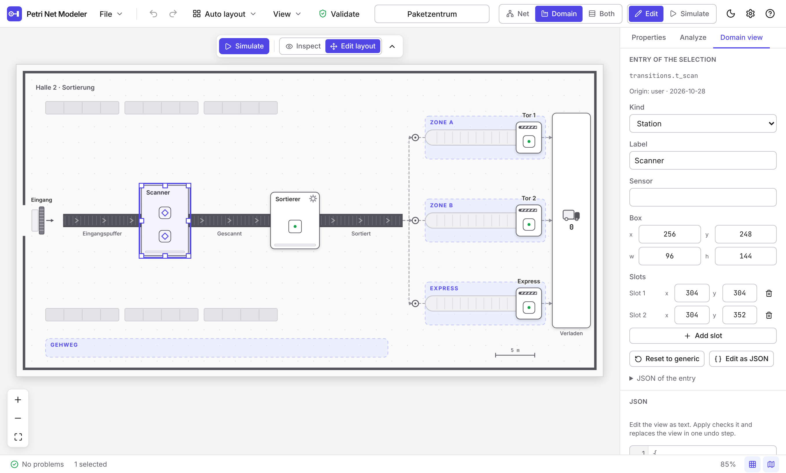
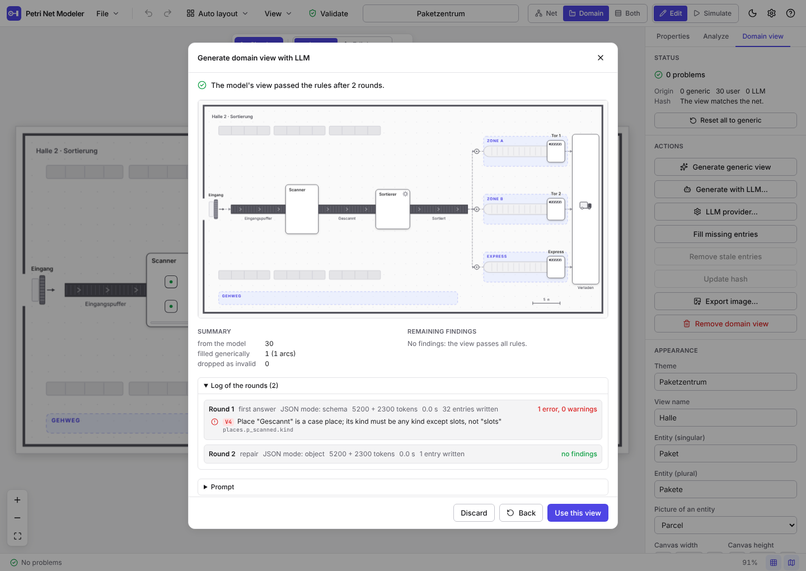

# Domain view

A domain view draws a Petri net in the terms of its domain: a hall with conveyor belts, stations and loading gates, a
floor plan with rooms, desks and doors, or, when nothing better is known, a generic picture of belts and stations. It
is a second view next to the net editor, drawn on a Canvas 2D from the net, a **mapping** and a marking.

The principle, which every part of the design follows: **the view shows, the net decides.** A mapping says _where_ and
_as what_ an element is drawn. It contains no durations, weights, rates or conditions (the net has them), and nothing
in it changes how the net behaves. The mapping is data that a person, a tool or a language model can write; it is
checked against the net instead of trusted (rules V1 to V8 below).

The code lives in `packages/domain` (`@pnm/domain`). It depends on `@pnm/core` and `@pnm/layout` and has no React
dependency; the core does not depend on it.

## Where the mapping is stored

In the net document under `domainView` (see [format.md](format.md)). The format version stays `1.0`; files without the
field are valid as before. The core stores the value as it is (`unknown`) and `@pnm/domain` validates it:

```ts
import { validateDomainView } from '@pnm/domain';

const { ok, view, diagnostics } = validateDomainView(net, net.domainView);
```

Editing the net does not touch the mapping. A mapping that no longer fits (a place was deleted, an element was added)
is reported by the rules V2, V3 and V7 and repaired with _Fill missing entries_ and _Update hash_.

## Schema

All objects are strict: unknown keys are errors (rule V1). `domainViewJsonSchema()` returns the JSON Schema (draft
2020-12) for prompts and external tools. Coordinates are pixels of the canvas (`meta.canvas`), the origin is the top
left corner. `Point` is `[x, y]`, `Rect` is `[x, y, width, height]`.

```jsonc
{
  "schemaVersion": 1,
  "netHash": "fnv1a64:c2edca7dd6f2bd35",
  "meta": {
    "theme": "Paketzentrum",
    "viewName": "Halle",
    "entity": { "singular": "Paket", "plural": "Pakete", "sprite": "parcel" },
    "canvas": { "width": 1200, "height": 640 },
    "metersPerPixel": 0.0625, // optional
  },
  "places": {
    "<placeId>": {
      "kind": "conveyor",
      "path": [
        [96, 320],
        [256, 320],
      ],
      "label": "Eingangspuffer",
    },
  },
  "transitions": {
    "<transitionId>": { "kind": "station", "box": [256, 248, 96, 144], "slots": [[304, 304]] },
  },
  "arcs": {
    "<sourceId>><targetId>": {
      "path": [
        [790, 320],
        [810, 320],
      ],
    },
  }, // optional
  "decor": [{ "kind": "wall", "segs": [[16, 16, 1184, 16]], "width": 5 }], // optional
  "provenance": { "places.<id>": { "source": "user", "at": "2026-10-28T09:00:00.000Z" } },
}
```

`entity.sprite` is the picture of a case: `parcel`, `person`, `vehicle`, `document` or `dot`.

### Places

| Kind             | Fields           | Picture                                                                                                     |
| ---------------- | ---------------- | ----------------------------------------------------------------------------------------------------------- |
| `conveyor`       | `path`, `label?` | A belt with rollers and direction chevrons. Cases stand along the path from its end backwards, 16 px apart. |
| `queue`          | `path`, `label?` | A dashed lane with a bar and an arrow at the head. The same placement of cases.                             |
| `buffer`         | `path`, `label?` | A framed band with a mark for every case. The same placement of cases.                                      |
| `slots`          | `of`, `label?`   | The resource places of a transition: one cell per slot of the transition (see below).                       |
| `pool`           | `pos`, `label?`  | A circle with the number of tokens.                                                                         |
| `source`, `sink` | `box`, `label?`  | A box with an arrow in or out and the number of tokens (a truck for parcels, a door for people).            |
| `hidden`         | `reason`         | Not drawn.                                                                                                  |

When more cases wait on a path than fit, the last place shows a counter `+n`.

### Transitions

| Kind                         | Fields                                        | Picture                                                                      |
| ---------------------------- | --------------------------------------------- | ---------------------------------------------------------------------------- |
| `station`, `machine`, `gate` | `box`, `slots?`, `label?`, `sensor?`          | A card with a status bar; a machine has a gear, a gate a barrier.            |
| `area`, `rooms`              | `box`, `slots`, `rooms?`, `label?`, `sensor?` | A floor area with desks, or rooms (`rooms`) with tables.                     |
| `door`, `dock`, `waypoint`   | `pos`, `pass?`, `label?`, `sensor?`           | A door with its swing, a loading dock, a marker on a route (`pass`: a ring). |
| `hidden`                     | `reason`                                      | Not drawn.                                                                   |

`slots` are the points where the firings of a transition are shown. If a resource place of kind `slots` refers to the
transition, its tokens are the free cells; a firing under way occupies the cell with its index and shows the case
there. `sensor` is free text for the hover card (which sensor would detect the firing in reality).

### Decor and arcs

`decor` is scenery: `room` and `zone` (areas with a label), `wall` (segments `[x1, y1, x2, y2]`), `label`, `furniture`
and `scale` (a scale bar with a label). `arcs` are optional connectors drawn as dashed lines with an arrowhead; keys
are `<sourceId>><targetId>` and the direction of the net arc counts.

### Provenance

Every entry has a provenance (`generic`, `user` or `llm` with an optional model name, plus a timestamp) under the key
`places.<id>`, `transitions.<id>` or `arcs.<key>`. The domain panel counts them; the JSON editor marks every entry that
the user changed as `user`.

## Roles and kinds

The kind of a place must fit its role, computed by `placeRole` of `@pnm/core` (respecting the `role` override of the
place):

| Role       | Allowed kinds                                     |
| ---------- | ------------------------------------------------- |
| `resource` | `slots`, `pool`, `hidden`                         |
| `sink`     | `sink`, `hidden`                                  |
| `source`   | `source`, `queue`, `conveyor`, `buffer`, `hidden` |
| `case`     | everything except `slots`                         |

A transition without input places (an arrival) must be a `door`, a `dock` or `hidden`. A place of kind `slots`
names a transition (`of`) that it forms a loop with: arcs in both directions between them.

## Rules

`validateDomainView(net, view)` returns diagnostics with the rule, severity, path (`places.p1.path[0]`), message and,
where there is one, the element of the net. The view is `ok` when there is no error. The view is returned as soon as
V1 passes, so it can still be drawn if other rules fail.

| Rule | Check                                                                                                                                                              | Severity |
| ---- | ------------------------------------------------------------------------------------------------------------------------------------------------------------------ | -------- |
| V1   | The schema holds and there are no extra fields. Fields that describe behaviour (duration, weight, rate, condition, ...) get a message that says so.                | error    |
| V2   | Every key of `places`, `transitions`, `arcs` and `provenance` names an element of the net; arcs only for existing arcs, in the direction of the net.               | error    |
| V3   | Every place and every transition has an entry (`hidden` counts).                                                                                                   | error    |
| V4   | The kind fits the role (table above), a transition without input is a door, a dock or hidden, and `slots.of` is a transition that the place loops with.            | error    |
| V5   | Geometry: points and rectangles inside the canvas, paths with at least two points and a length, rectangles with an area, slots inside the box of their transition. | error    |
| V6   | Room: a transition has at least as many slots as its resource place has initial tokens; a queue, conveyor or buffer is at least 160 px (ten tokens) long.          | warning  |
| V7   | `netHash` matches the net, so the view is not out of date.                                                                                                         | warning  |
| V8   | A place that holds cases (role `case`) is not `hidden`.                                                                                                            | warning  |

The tests contain for every rule an example that triggers exactly this rule (`packages/domain/test/validate.test.ts`).

## The net hash

`netHash(net)` is FNV-1a (64 bit) over the sorted ids of the places, the sorted ids of the transitions and the sorted
arcs as `source>target`, written `fnv1a64:` plus 16 hex digits. Names, positions, markings and inscriptions do not
enter, so renaming or moving elements keeps a view up to date and adding, removing or reconnecting elements does not.
The hash only detects stale views, it is not a security feature, which is why a short synchronous hash is enough (the
first draft of the feature asked for SHA-256, which would make the validation asynchronous). See
[ADR 0008](adr/0008-domain-view-mapping.md).

## The generic view

`genericDomainView(net)` makes a mapping for any net, deterministically:

- The editor positions are scaled into the canvas (1200 px wide, as high as needed between 420 and 900 px, 80 px margin,
  aspect ratio kept). Nodes without a position go on a grid; `genericDomainViewWithLayout` lays out nodes that all sit
  at one spot with ELK first.
- An arrival becomes a `door`, every other transition a `station` (56 px square; a resource with n initial tokens makes
  n slots in a grid and the box grows).
- A resource place that loops with a transition becomes its `slots` (the first one per transition); other resources are
  `pool`s. A sink is a `sink` box, a source place a `queue` towards its first transition, every other place a
  `conveyor` from the middle between the transition before it and the place to the middle between the place and the
  transition behind it, at least 160 px long.
- Arcs get a two-point path from border to border; the arcs of resource slots, which sit inside their transition, get
  none.
- The scenery is a title label and a scale bar. Every entry has the provenance `generic`.

It passes V1 to V5 for every net (a property test over 250 random nets with and without positions checks this) and
may warn under V6 for crowded nets. `fillMissing(net, view)` completes a mapping for the current net: entries of
elements that are gone are dropped, missing entries and entries that break V2 to V5 get generic ones.

## Drawing

`buildScene(net, view, marking, options)` turns the mapping into a `Scene`: draw commands in the layers `decor`, `arcs`,
`places`, `transitions`, `tokens`, `labels` and `highlight`, each with the id of the net element it belongs to, plus
hit regions. `paintScene(ctx, scene, palette)` draws a scene on a `CanvasRenderingContext2D`; the colors come as a
parameter (`LIGHT_PALETTE`, `DARK_PALETTE`), nothing is read from the page. `hitTest(scene, point)` finds the element
under a point (resource cells before stations before belts before arcs), `withHighlight` adds the outline for hover and
selection without rebuilding the scene.

Marking: tokens of places with a path are drawn as sprites along it, `pool`, `source` and `sink` show a number, resource
cells show free (a green dot), busy (a green frame with the case) or not available (crossed). In the editor the view
shows the initial marking; while simulating it shows the current marking and the firings under way as busy cells, and
the card of a transition with a firing gets a green frame. `buildScene` shows one state, as a picture. The running view
uses the animation below instead.

## In the app

- The header has a switch _Net | Domain | Both_ (keys `1`, `2`, `3`). In _Both_ the net is above and the view below, the
  divider can be dragged (or moved with the arrow keys) and is remembered. Selection, hover and the simulation are
  shared.
- The view fits itself into the area and refits on resize until you zoom. The wheel pans, `Ctrl`/`Cmd` + wheel and a
  pinch zoom, dragging pans, `F` fits, `Ctrl+0` resets the zoom; the zoom is in the status bar.
- Hovering an element shows a card (name, id, kind of drawing, role, tokens, origin, sensor) and lights up its
  counterpart in the net, and the other way round. A click selects it.
- The mode _Edit layout_ (key `E`) lets you move, resize and reshape the entries in the picture, see _Editing the view_.
- The tab _Domain view_ in the right panel shows the problems, the origin of the entries and the state of the hash, the
  actions _Generate generic view_, _Fill missing entries_, _Update hash_ and _Remove domain view_, the appearance
  (theme, name, entity, canvas size), the entry of the selected element and the whole mapping as JSON with live checks.
  Applying the JSON replaces the view in one undo step.

## Editing the view

The switch _Inspect | Edit layout_ in the bar of the domain view (key `E`, only while the net is in the editing mode)
turns the picture into an editor. The JSON editor of the panel stays as the second way; both go through the same rules
and every change is checked at once.

- **Selecting.** A click selects an element (the selection is shared with the net), a piece of decor, or a dashed
  placeholder of a hidden element. The selected entry gets a frame and handles in the accent colour. They are drawn in
  screen pixels, so they stay sharp and the same size at any zoom.
- **Handles.** A box (station, machine, gate, area, rooms, source, sink, room, zone, furniture) has a surface to drag and
  eight resize handles; rooms of a `rooms` area have their own surface and four corners. A position (door, dock,
  waypoint, pool, label, scale bar) has one round handle, a scale bar a second one at its end. A path (queue, conveyor,
  buffer, arc) has a round handle per point and a small one in the middle of each segment: click it to add a point
  there, or press and drag to add and place it in one move. A double click on a point removes it (a path keeps two).
  Slots are diamonds that move inside their station; wall segments have a handle at each end.
- **Dragging.** The picture follows the pointer while you drag, nothing is written before you let go, and then the whole
  drag is **one** undo step. `Esc` cancels a drag. The grid of the editor (8 px, key `G`) applies; `Alt` switches it
  off for the drag. `Shift` on a corner handle keeps the proportions. Coordinates are whole numbers and stay inside the
  canvas, boxes are at least 24 × 24 px, slots stay in their box, resizing scales slots and rooms with the box. A
  number next to the pointer shows where the entry is and how large.
- **Arcs follow.** Moving an element moves the end of the arcs that touch it, and so does moving the end of a belt.
  Resizing leaves arcs where they are.
- **Keys.** The arrow keys move the selection by 1 px, with `Shift` by 8 px. `Delete` does **not** delete the net
  element: it hides the entry (`hidden`, reason _hidden by user_, a toast with _Undo_), and the element stays in the
  net. Only decor is really removed. `F2` or a double click edits the label in place; an empty label brings the name of
  the element back.
- **Context menu.** On an entry: edit label, _Change kind_ (only the kinds that rule V4 allows for the role, converting
  the geometry: a box becomes a point at its middle, a point becomes a box around it), add or remove a point, add or
  remove a slot (at the click), hide or show, reset the entry to generic, edit JSON (selects the entry in the JSON
  editor). On the empty sheet: add room, zone, wall, label, furniture or scale bar here.
- **Hidden entries** are shown as dashed outlines at the position where the generic view would put them, so that they
  can be found and shown again (_Show_ gives them their generic form). Arcs of a hidden element lose their path, and
  _Show_ draws them again.
- **Provenance.** Every hand change sets the origin of the entry to `user`; _Show_ and _Reset entry to generic_ set it
  to `generic`. The panel counts the origins; _Reset all to generic_ replaces everything after a confirmation.
- **Panel fields.** The entry section of the panel shows the same entry with fields for the kind, the label, the sensor,
  `pass`, the box or position as numbers, the points of a path and the slots. Each commit goes through the same
  functions as a drag. The JSON of the entry is one click away.
- **Out of date.** When the net has changed (V7) the panel starts with a card _The view is out of date_. It lists the
  elements without an entry (V3) and the entries of removed elements (V2) and offers _Fill missing entries_ (only the
  new elements get a generic entry, everything else stays as it is), _Remove stale entries_ and _Update hash_, each as
  its own undo step. The action _Fill missing entries_ in the action list does both of the first two at once.

The edits are pure functions of `@pnm/domain` (`handlesFor`, `hitHandle`, `moveEntry`, `resizeEntry`, `setBox`,
`movePoint`, `insertPoint`, `removePoint`, `moveSlot`, `addSlot`, `removeSlot`, `setEntryKind`, `setLabel`,
`hideEntry`, `showEntry`, `addDecor`, `removeDecor`, `markUser`, ...). Each returns a new view, changes only the
addressed entry (and the arcs that move along when the net is given) and keeps the rules V1, V4 and V5 satisfied; a
property test over random nets checks this after random sequences of edits. See
[ADR 0011](adr/0011-domain-view-editing.md).



## Animation

While a simulation runs, the view shows every event of the stream as a movement or a visible change, and the
simulator never waits for it. The pieces are pure functions in `@pnm/domain`; the app only feeds them and draws.

| Function                                        | What it does                                                                                                         |
| ----------------------------------------------- | -------------------------------------------------------------------------------------------------------------------- |
| `layoutTokens(net, view, state)`                | Where every token stands: on a belt, a lane or a buffer, on the slot of a firing, or on a route.                     |
| `applyEvents(prev, events, before, after, ...)` | Turns a bundle of events into motions, flashes and counters, from the layout before and after the bundle.            |
| `sampleSprites(layout, anim, now, simTime)`     | The sprites at one moment: resting ones at their place, moving ones on their route (`sampleTokens` gives positions). |
| `buildStaticScene` and `buildDynamicScene`      | The part of the picture that depends on net and view only, and the part that changes every frame.                    |
| `stationStatus`, `queueLevel`, `stationInfos`   | Free, busy, busy-full, blocked or starved stations, and the yellow and red of queues.                                |
| `caseTrail`, `caseActivities`                   | The steps of one case in the stream, for following a case.                                                           |

**Tokens and their identity.** A token on a place is known by its `TokenMeta.id` from the simulation state (the view of
the simulation carries the metadata of all tokens next to the marking). While a firing runs, its cases are not on a
place: they stand on the slot of the firing under the key `f<firing>:<case>`. Resource tokens have no sprite; they are
the cells of the slots.

**Placement.** On a belt, lane or buffer the tokens stand from the head backwards, 16 px apart, the oldest at the head.
What does not fit is stacked at the start behind a counter `+n`. A firing puts the cases it holds on its slot (several
cases slightly apart). On a waypoint that only lets cases pass (`pass: true`) the case travels along the route from the
belt before, over the connectors and the waypoint, to the belt behind, in proportion to the simulation time of the
firing. Pools, sources and sinks are numbers.

**From event to picture.** The motion of a token is the difference between the layout before and after a bundle,
linked through the events:

| Event                          | What is shown                                                                                                                                                         |
| ------------------------------ | --------------------------------------------------------------------------------------------------------------------------------------------------------------------- |
| `spawn` through a door or dock | The door flashes. The case appears there and moves on with the `complete` of the arrival.                                                                             |
| `start`                        | The case moves from its place along the connector to the slot. The slot is _reserved_ (hatched) until the case arrives, then it turns busy and a progress ring fills. |
| `complete`                     | The case moves from the slot along the connector onto the next belt, to its spot at the end of the queue.                                                             |
| `complete` into a sink or pool | The case moves into it and disappears; the counter counts up when it arrives.                                                                                         |
| `marking-edited`               | The place flashes; tokens that were added or removed appear or vanish.                                                                                                |
| anything at a `hidden` element | Nothing is drawn; the log notes it as `hidden`.                                                                                                                       |

Chains inside one bundle (a case that is taken again at once) become one route, and the move belongs to the last event
of the chain; the others light up their station. A move follows the connector of the view (`arcs`, key
`<source>><target>`), else a straight line, and lasts 300 ms of wall-clock time with ease-in-out, whatever the speed
of the simulation. At most 60 tokens move at a time; further ones jump. A token that is moved again while it is under
way continues from where it is. Speed _max_ and `prefers-reduced-motion` make every duration 0: tokens jump and nothing
flashes, but counters, colors and cells follow the events all the same.

**Log of handled events.** `AnimationState.handled` lists what the renderer did with every event that concerns a visible
element: `motion`, `flash`, `counter` or `hidden`. Every motion, flash and counter carries the id of the event that
caused it. The tests compare this log with the event stream (acceptance A2): over 30 simulated minutes of the parcel
center, in bundles from 0.4 s to 90 s, no event is lost and no animation has no event.

**States and colors.** A station is _busy_ when a slot is in use (green frame), _busy-full_ when all slots are in use and
cases wait in front of it (amber frame, tint and bar), _blocked_ when, in addition, the waiting cases have reached the
yellow limit of the queues, 6 by default (red frame and tint, red bar), _starved_ when nothing is in use and nothing
waits (neutral) and _free_ otherwise. One waiting case at a full station is normal; only a growing queue turns it red. A queue, belt or buffer that holds cases turns yellow from 6 and red from 10 tokens; the limits are
those of the key figure settings (_Queue highlighting_). A room of a `rooms` transition lights up while one of its slots
is in use. Firings show a ring around the slot (or a bar under a desk or table) that fills with the simulation time.

**Drawing.** The static part (sheet, scenery, belts, cards, labels) is rendered once into an offscreen canvas and redrawn
80 ms after the last change of the zoom (scaled in between), the dynamic part is drawn every frame on top. Sprites come
from a cache of pre-rendered images. The loop of `requestAnimationFrame` only runs while the simulation plays or
something moves, otherwise the view rests. With 200 tokens, layout, animation and the dynamic scene take about 1 ms per
bundle and the frame callback about 1 ms (measured in Node and in Chromium, see ADR 0009).

## In the app (simulation)

- A floating bar at the top of the view starts the simulation (_Simulate_) and, while it runs, offers play and pause,
  step, back, reset, the speed (1x to 60x, max), the clock, the cases in the system and _Edit_. It uses the same actions
  and shortcuts as the simulation panel. A small button hides it together with the key figures.
- The strip at the bottom right shows throughput per hour, mean cycle time and cases in the system (with a note during
  the warm-up). The picture is fitted so that the bar, the strip, the zoom buttons and the case card do not cover it.
- The hover card of a belt shows the waiting cases, the mean wait and whether it is getting long; the card of a station
  its state, the slots in use, the waiting cases and the use of its resource; the card of a resource the free tokens.
- A click on a case follows it: its sprite gets a ring, the stations it has been at a light frame, and a card at the
  bottom left lists its steps with the times. _Stop following_, a second click on the case or `Esc` let go.
- A click on a station, door or other transition selects it and, if it is enabled, fires it (with several bindings a
  list opens next to it). While simulating the net cannot be edited, so `Del` deletes nothing.

## Generating a view with an LLM

A language model can propose the mapping, and the checking program decides whether it is used. This is the division of
labour of the whole design: the model suggests, the rules V1 to V8 judge, and the net alone defines the behaviour. No
model takes part in a simulation; it is asked once, before, and the result is an ordinary mapping (ADR 0010).

The code lives in `packages/llm` (`@pnm/llm`). It needs only `fetch`, so it runs in the browser and in Node, and it
depends on `@pnm/core`, `@pnm/domain` and `zod`.



### Flow

1. **Prompt.** `buildPrompt` writes a system text (the task, the rules for kinds and geometry in short form, the output
   as one JSON object) and a user text: the description of the domain, the size of the canvas, a compact form of the net
   (`compactNet`: places and transitions with name, role, tokens and normalised editor position, arcs as pairs), the
   JSON Schema of the answer without `netHash` and `provenance`, and two worked examples (parcel center and smart
   office, shortened, never one that has the structure of the net itself). The prompts are in English; labels take the
   language of the names in the net.
2. **Answer.** The reply is read as JSON, also from a Markdown code block or from the first complete object in a text.
   The tool sets `netHash` and writes provenance `llm` with the model name and the time on every entry.
3. **Check.** The answer is merged entry by entry and checked with the rules V1 to V8.
4. **Repair.** If there are errors, they go back as a repair request: each finding with its rule, path and text, and the
   entries it is about. The model returns only a partial object (`places`, `transitions`, `arcs`, `decor` with the
   corrected entries), which replaces exactly those entries. Warnings (V6, V8) do not trigger a repair. At most three
   requests are made in all (the first answer and two repairs).
5. **Filling.** Entries that are still invalid afterwards are dropped (`dropped`) and everything that is missing is
   filled in with the generic view (`filled`, provenance `generic`). The result always passes V1 to V5. If the model
   fails after the first round (network, answer that is no JSON), the loop ends and the gaps are filled with a note;
   only a failure in round 1 is an error for the person.
6. **Record.** The result carries a log of the rounds (mode of the JSON request, tokens, findings, time, what was
   written), the prompt of the first request, the model, the server and the paths that were filled or dropped.

### Provider

Any server with an OpenAI-compatible chat API: `POST <base URL>/chat/completions` with the messages and, depending on
the JSON mode, a `response_format`. The mode _automatic_ tries a strict `json_schema` first, falls back to
`json_object` when the server refuses the field, and then to plain text; the mode that worked is remembered for the
session and shown per round. The settings dialog (_LLM provider…_ in the header, the panel or the generation dialog)
offers presets for Ollama (`http://localhost:11434/v1`) and LM Studio (`http://localhost:1234/v1`) and a custom
server, a model name with a button _Load models_ (`GET /models`), a temperature (default 0.2), the JSON mode and _Test
connection_. Failures are classified (`network`, `auth`, `rate-limit`, `timeout`, `bad-response`, `parse`) and the
dialog explains what to check.

### In the app

- _Generate with LLM…_ in the tab _Domain view_ (and in the empty domain view) opens a dialog for the description of
  the domain, the canvas size and shows the provider. It is disabled while a simulation runs, and starting a simulation
  stops a running generation.
- A list shows the progress (prompt, waiting for the model in round _n_ of 3, checking, sending the findings back,
  filling) and can be cancelled; _Continue in background_ closes the dialog and the status bar shows the round.
- The result has a preview of the view, the number of entries from the model, filled and dropped, the remaining
  findings, the log of the rounds and the prompt (with a copy button). _Use this view_ replaces the mapping and the
  record in one undo step (a note warns if the current view has entries by a person); _Discard_ drops the result.
- The panel shows _Generated by `<model>` on `<date>`_ with a link to the log, a badge _LLM_ at entries from the model,
  and the hover card says `LLM (<model>)`.

### What is stored, and what is not

The mapping stays strict: no field is added to it. The record goes in the net document under `domainViewGeneration`
(see [format.md](format.md)), is written right after the view and removed together with it. It contains the model, the
server address without user name, password, query or fragment, the description, the prompt, the log and the paths. The
**API key is never stored** in a net, an export or a log; the app keeps it in its own `localStorage` entry apart from the
other settings, so anyone who can use that browser profile can read it.

### Privacy and Ollama

When a view is generated, the structure of the net (names, ids, arcs, tokens), the description and the examples are
sent to the server of the provider. With a cloud service that means to a third party; use a local model for nets that
must not leave the machine. A browser can call a local Ollama only if the server allows the origin of the page:
start it with `OLLAMA_ORIGINS` set, for example `OLLAMA_ORIGINS="http://localhost:5173" ollama serve`.

### Evaluating a model (acceptance A6)

`pnpm --filter @pnm/llm eval -- --base-url http://localhost:11434/v1 --model qwen2.5:14b` generates the view of the
parcel center and of the smart office, prints the findings per round and writes a report table and the views to
`docs/eval/` (see [docs/eval/README.md](eval/README.md)). The tests run the same script against a small local HTTP
server, and a scripted provider checks the repair in round 2 for both examples without a network.

## Limits

Editing by dragging in the view (D4) is still missing. A generated mapping is only as good as the model: the rules check
that it fits the net, not that it is beautiful, and what stays invalid after three rounds is replaced by the generic
entries. Tokens
of JSON nets show as plain cases, a transition's `slots` have no order beyond their index, and a firing that holds no
case (work on resources only) is shown as a busy slot without a sprite. Stepping back or resetting snaps the picture to
the state instead of playing backwards. The motion of a token that is taken again within one bundle is attributed to the
last event of the chain.
